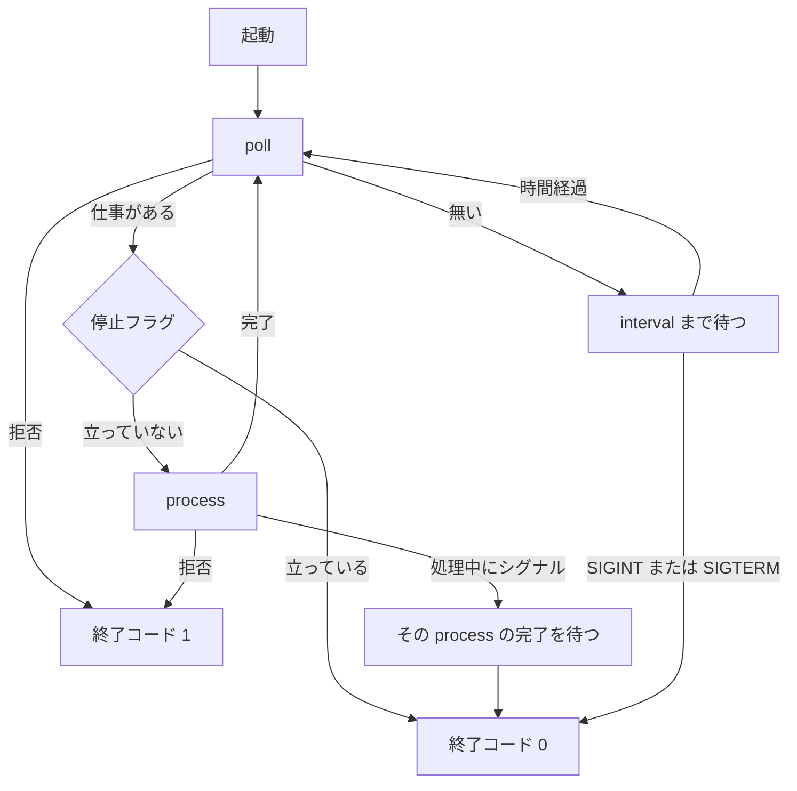

# 1 パッケージ骨格と install / run CLI

対象は [Issue #1](https://github.com/paterapatera/sdd-cur/issues/1)。計画の「配布と実行」のうち、パッケージ入口と、課題ランナーのループの骨格を作る。

## 受け入れ条件

- `bun src/cli.ts install` と `bun src/cli.ts run` でそれぞれの処理が起動する。
- `run` は SIGINT または SIGTERM までループする。処理のあいだは次の `poll` を呼ばない。処理が終わったら、再び `poll` する。

## 範囲外

次は作らない。

- GitHub Issue と GitHub への接続（#2）
- ラベルの作成（#3）
- SDD スキルの本文（#5）。`install` はコピー機構だけを持つ
- 実装の本体、受け入れ手順、ラベル遷移（#6）
- 完了処理（#7）
- npm への公開

## 決定

| 項目 | 内容 |
|---|---|
| 実行 | TypeScript を Bun が直接実行する。依存パッケージは置かない |
| 開発時の起動 | `bun src/cli.ts <subcommand>`。`package.json` の script 名は `install` にしない |
| `install` の引数 | 省略時は `~/.cursor/skills`。あるときはプロジェクトのルートを一つ受け、`<root>/.cursor/skills` に置く |
| コピー単位 | パッケージ内 `skills/<名前>/` を、中のファイルとディレクトリを含めて再帰的にコピーし、宛先の同名ディレクトリを置き換える。置き換え後の中身はパッケージ側と一致し、パッケージから消えたファイルは残らない。宛先の直下にある、パッケージに無いディレクトリとファイルは残す |
| スキルが無いとき | `skills/` が空でも `install` は成功する。宛先ディレクトリは作る |
| `run` の仕事 | `poll` と `process` に分ける。既定の `poll` は常に `null` を返す |
| 間隔 | 既定は 1 分。`--interval-min` で 1 以上 1440 以下の整数分に変える。範囲外や整数でない値は終了コード 1 とする。待機は終了シグナルで中断する |
| 終了 | SIGINT と SIGTERM。処理中ならその `process` が終わってから抜け、次の `poll` はしない。終了コードは 0 |
| 同時起動 | ロックは持たない。クローンごとに別プロセスで動く |

## ディレクトリ

```
package.json
src/cli.ts
src/install.ts
src/run.ts
src/runner.ts
skills/.gitkeep
```

`package.json` は次の形にする。

- `name` は `@paterapatera/sdd-cur`
- `version` は `0.0.0`
- `private` は `true`
- `type` は `module`
- `bin.sdd-cur` は `src/cli.ts`
- `scripts.sdd-cur` は `bun src/cli.ts`
- `scripts.test` は `bun test`

`src/cli.ts` の先頭は `#!/usr/bin/env bun` とする。公開後にパスへ入ったときは `sdd-cur install` と `sdd-cur run` で同じ入口を呼ぶ。

サブコマンドが無いとき、および未知のサブコマンドのときは、使い方を標準エラーへ書き、終了コード 1 で終わる。`--help` のときは、使い方を標準エラーへ書き、終了コード 0 で終わる。

`install` にプロジェクトのルートが無いときは、引数省略として `~/.cursor/skills` へ置く。これは終了コード 0 である。

使い方は次の二行で足りる。

```
sdd-cur install [project-root]
sdd-cur run [--interval-min <1 以上 1440 以下の整数>]
```

## install

1. 引数が無いとき、宛先は `node:os` の `homedir()` に `.cursor/skills` を足したパスである。
2. 引数が一つあるとき、それはプロジェクトのルートである。宛先は、そのパスを `path.resolve` したうえで `.cursor/skills` を足したパスである。引数が `.cursor/skills` で終わっていても、さらに `.cursor/skills` を足す。呼び手はプロジェクトのルートを渡す。
3. 引数が二つ以上、または空文字のときは、使い方を書いて終了コード 1 で終わる。
4. 渡したパスが存在しない、またはディレクトリでないときは、終了コード 1 で終わる。
5. 宛先ディレクトリを再帰的に作る。
6. パッケージ内の `skills/` を読む。場所は `src/install.ts` から見て `../skills` である。`import.meta.dir` からの相対パスにする。`bun` で直接実行しても、パッケージとして展開されても同じ位置になる。
7. `skills/` の直下にあるディレクトリだけをスキルとする。各ディレクトリは、中のファイルとディレクトリを含めて、宛先の同じ名前へ再帰的にコピーする。宛先に同名があるときは、そのディレクトリを削除してからコピーする。コピー後のスキルの中身は、パッケージ側のそのディレクトリと一致する。宛先の直下にあるファイル、およびパッケージに無いディレクトリは残す。
8. 標準出力に宛先の絶対パスを一行書く。コピーしたスキル名が無いときは、その次の行に「配置するスキルはありません」と書く。成功時の終了コードは 0 である。

## run

ループは `src/run.ts` に置く。課題の取得と処理は `src/runner.ts` の関数として差し替える。

```ts
export type WorkItem = {
  id: string
}

export type Runner = {
  poll: () => Promise<WorkItem | null>
  process: (item: WorkItem) => Promise<void>
}
```

既定の `poll` は `null` を返す。既定の `process` は何もしない。#6 はこの二つを実装に差し替える。ループの形は変えない。



- 起動時に SIGINT と SIGTERM を受け、停止フラグを立てる。
- `poll` が仕事を返したときは、その `process` が解決するまで次の `poll` を呼ばない。
- `process` の途中でシグナルを受けたときは、その `process` が終わってからループを抜ける。抜け際に `poll` は呼ばない。
- `poll` が仕事を返した時点で停止フラグが立っていれば、`process` は呼ばず、終了コード 0 で終わる。
- `poll` または `process` が拒否したら、標準エラーに理由を一行書き、次の `poll` は呼ばず、終了コード 1 で終わる。再試行は #6 が `poll` と `process` の内側で行う。ループは、一回の呼び出しが戻るまで次を取らない。
- `poll` が `null` のときは、`--interval-min` 分待つ。省略時は 1 である。1 未満、1440 を超える値、整数でない値は終了コード 1 とする。
- 待機は停止フラグで中断する。間隔の残りを待たない。
- 標準出力は次の行だけを書く。`処理を開始します: <id>`、`処理を終了します: <id>`、`終了します`。空の `poll` は出力しない。

## テスト

`bun test` で実行する。ホームディレクトリや実行中の Cursor のスキルは触らない。

`install` は関数を直接呼ぶ。

- 引数なしの宛先が、渡したホームに `.cursor/skills` を足したパスである。
- プロジェクトのルートを渡すと、`<root>/.cursor/skills` になる。
- 一時ディレクトリ上の `skills/` から、スキルディレクトリがコピーされる。
- 宛先に既にある別のディレクトリは残る。
- 同名のスキルは、パッケージ側の内容に置き換わる。
- 同名スキルの中に、パッケージから消えたファイルは残らない。
- `skills/` が空でも宛先が作られ、成功する。
- 存在しないプロジェクトのルートは失敗する。

`run` はループ関数へ `poll`、`process`、待機、停止を注入して試す。

- `poll` が `null` のあと停止すると、`poll` は一度だけ呼ばれ、終了する。
- `process` の実行中に二度目の `poll` が呼ばれない。`process` が終わったあと、停止していなければ `poll` が再び呼ばれる。
- `process` の途中で停止フラグが立つと、その `process` の完了後にループを抜け、追加の `poll` は無い。
- 待機中の停止は、間隔の満了を待たない。
- `poll` が仕事を返した時点で停止フラグが立っていれば、`process` は呼ばれない。
- `poll` または `process` が拒否すると、次の `poll` は呼ばれず、終了コード 1 で終わる。
- `--interval-min` が 1 未満、1440 を超える、または整数でないときは終了コード 1 になる。1 と 1440 は受け付ける。

起動の確認は、一時ディレクトリを使った子プロセスで行う。

- `bun src/cli.ts install <temp>` が終了コード 0 で、`<temp>/.cursor/skills` を作る。
- `bun src/cli.ts run --interval-min 1` を起動し、SIGTERM を送ると、1 分の満了を待たずに終了コード 0 で終わる。

## 作業の一覧

1. `package.json` と `src/cli.ts` を置き、未知のサブコマンドが終了コード 1 になることを確かめる。
2. `install` の宛先解決とコピーを作り、関数テストを通す。
3. `run` のループと既定の空ランナーを作り、注入テストを通す。
4. 子プロセスで `install` と `run` の起動と終了を確かめる。
