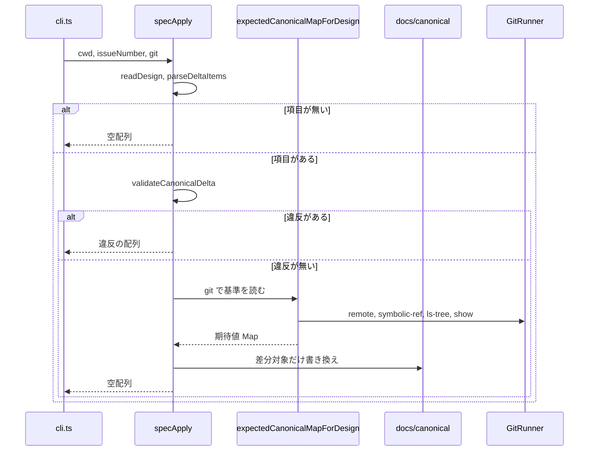

# 196 設計の正本への差分を docs/canonical/ に書き込む spec-apply を足す

<!-- sdd-cur:form -->

対象は [Issue #196](https://github.com/paterapatera/sdd-cur/issues/196)。設計の `## 正本への差分` を `docs/canonical/` へ書き込むのは、実装作成役である。`spec-diff` は、デフォルトブランチの正本に差分を当てた期待値を計算し、作業ツリーと比べる。期待値はファイルへ書かない。`sdd-cur spec-apply <番号>` を足し、同じ手順の期待値を作るうえで、差分対象の識別子だけを `docs/canonical/<領域>.md` へ書く。

重なる課題は #123、#128 である。

比べる相手は、OpenSpec の `archive` と Delta Specs である。OpenSpec は、変更フォルダの delta spec を `archive` で正本へ統合する。統合のあと、領域ファイルに要求が一つも残らないときは、その領域ファイルを除く。`spec-apply` も、削除のあと `## REQ-<番号>` の見出しが一つも無い領域ファイルは、作業ツリーから除く。

手を入れる対象は、`src/conventions.ts`、`src/cli.ts`、`docs/policy.md`、`AGENTS.md`、`README.md`、`skills/sdd-cur/conventions.md` の「仕様の正本」である。

## 受け入れ条件

- 1. 条件: `src/cli.ts` の `switch` を見る 主体: `src/cli.ts` 結果: `spec-apply` がある
- 2. 条件: 使い方の表示を見る 主体: `src/cli.ts` 結果: 行全体が `sdd-cur spec-apply <番号>` である行がある
- 3. 条件: `docs/policy.md` の構成の表の `src/cli.ts` の行を見る 主体: その行 結果: バッククォートで囲んだ `spec-apply` を含む
- 4. 条件: `AGENTS.md` の「コマンド」のコードフェンスを見る 主体: そのフェンス 結果: 行全体が `bun src/cli.ts spec-apply <番号>` である行がある
- 5. 条件: 設計の `## 正本への差分` がある 主体: `spec-apply` 結果: `spec-diff` と同じ手順で期待値を作る。`docs/canonical/<領域>.md` へ書くのは、差分対象の識別子だけである
- 6. 条件: 追加の項目がある 主体: `spec-apply` 結果: その領域ファイルの末尾に、見出しが行全体で `## REQ-<番号>` である節を足す
- 7. 条件: 追加の項目の領域ファイルが無い 主体: `spec-apply` 結果: 最初の見出しが行全体で `# <領域>` であるファイルを作り、その末尾に受け入れ条件 6 の節を足す
- 8. 条件: 変更の項目がある 主体: `spec-apply` 結果: 同じ識別子の節の本文だけを置き換え、ほかの節の並びと本文は変えない
- 9. 条件: 削除の項目がある 主体: `spec-apply` 結果: その識別子の節を除く
- 10. 条件: `spec-apply` がファイルを書いたあと `spec-diff` を実行する。終了コードが 0 になる前提は、追加、変更、削除の対象でない節が、すでにリモートのデフォルトブランチの基準と一致していることである 主体: `spec-diff` 結果: 終了コードは 0 である
- 11. 条件: 設計に差分が無い、または設計が無い 主体: `spec-apply` 結果: 何も書かずに終了コード 0 で終わる
- 12. 条件: `validate` の「正本への差分」の検査に失敗する。失敗とは、追加する識別子が正本にあること、または変更する識別子か削除する識別子が正本に無いことである。検査は `validate` と同じ `validateCanonicalDelta` であり、識別子の集合は作業ツリーの `readCanonicalIds(cwd)` である 主体: `spec-apply` 結果: ファイルは書かない。違反は識別子ごとに標準エラーへ、`validateCanonicalDelta` が返す既存の日本語一行を書く。例は `追加する識別子が正本にあります: REQ-n` である。違反が複数あるときは一行ずつ標準エラーに書く。標準出力には書かない。終了コードは 1 である
- 13. 条件: 期待値の計算を見る 主体: `src/conventions.ts` 結果: `specDiff` から切り出した関数を `spec-apply` と共有する
- 14. 条件: 正本の一致の比較を見る 主体: `compareCanonicalMaps` 結果: 今の比較のまま使う
- 15. 条件: 節の本文を切り出して書き、再び読む 主体: 読み書き 結果: 切り出しは `canonicalReqBodiesFromMarkdown` と同じ規則であり、往復で本文が変わらないことをテストが確かめる
- 16. 条件: `## 正本への差分` の見出しの形と、`validate` の既存の検査を見る 主体: この課題 結果: 変えない
- 17. 条件: `spec-diff` の出力と終了コードを見る 主体: この課題 結果: 変えない
- 18. 条件: 既存の `docs/issues/<番号>/` を見る 主体: この課題 結果: 変えない
- 19. 条件: 正本にすでにある節のうち、追加、変更、削除の対象でない節の並びと本文を見る 主体: `spec-apply` 結果: 変えない。差分対象の識別子だけを書き換える
- 20. 条件: 実装スキルとサブエージェントの手順を見る 主体: この課題 結果: 変えない
- 21. 条件: 受け取る課題番号の数を見る 主体: `spec-apply` 結果: 一つである
- 22. 条件: 引数が一つでない 主体: `spec-apply` 結果: 終了コードは 1 であり、使い方を標準エラーへ書き、標準出力には書かない
- 23. 条件: 課題番号が不正である 主体: `spec-apply` 結果: 終了コードは 1 であり、標準エラーへ日本語の一行を書き、標準出力には書かない。その一行の字面は、設計で決める
- 24. 条件: 設計ファイルを読めない 主体: `spec-apply` 結果: 終了コードは 1 であり、標準エラーへ日本語の一行を書き、標準出力には書かない。その一行の字面は、設計で決める
- 25. 条件: git の起動に失敗した 主体: `spec-apply` 結果: 終了コードは 1 であり、標準エラーへ日本語の一行を書き、標準出力には書かない。その一行の字面は、設計で決める
- 26. 条件: README の「開発中の起動」を見る 主体: README 結果: `spec-apply` の起動例が 1 行ある。その行以外の、その節の既存の文は一文字も変わらない
- 27. 条件: `skills/sdd-cur/conventions.md` の「仕様の正本」を見る 主体: その節 結果: `spec-apply` が設計の `## 正本への差分` を `docs/canonical/` に書く旨の文が、1 文または 2 文ある。足す文以外の既存の文は一文字も変わらない

## 範囲外

次は、この要件に含めない。

- 実装スキルとサブエージェントの手順を変えること
- `spec-diff` の出力と終了コードを変えること
- `## 正本への差分` の見出しの形を変えること
- `validate` の既存の検査を変えること
- 既存の `docs/issues/<番号>/` を変えること
- 追加、変更、削除の対象でない、正本にすでにある節の並びと本文を変えること
- 依存パッケージ。トークンと環境変数の読み取り
- ホームディレクトリと、実行中の Cursor のスキルへの `install`
- 課題を作ること。課題を閉じること。ラベルを変えること

## 決定

| 項目 | 内容 |
|---|---|
| サブコマンド名 | `spec-apply` |
| 置き場所 | 期待値の計算と適用は `src/conventions.ts` の `expectedCanonicalMapForDesign` と `specApply`。`src/cli.ts` は `defaultGitRunner` を渡して `specApply` を呼ぶ |
| 引数 | 課題番号が一つ。うしろが一つでないときは `printUsage` を標準エラーへ書き、終了コード 1。標準出力は空 |
| `switch` | `spec-diff` の次に `case "spec-apply":` を足す。`default` より前である |
| 使い方の行 | `printUsage` の、行全体が `sdd-cur spec-diff <番号>` である行の次に、行全体が `sdd-cur spec-apply <番号>` である行を足す |
| 課題番号が不正 | `parseIssueNumberString` が拒否するとき、標準エラーは `番号が不正です` の一行。終了コードは 1。標準出力は空。`specApply` も `git` も呼ばない |
| 設計を読めない | 標準エラーは `仕様を読めません` の一行。終了コードは 1。標準出力は空。`git` は呼ばない |
| git の起動失敗 | `GitRunner` が例外を投げたとき、およびブランチ名を取る git の終了コードが 0 でないときは、標準エラーは `git を実行できません` の一行。終了コードは 1。標準出力は空。ファイルは書かない |
| 差分が無い | 設計ファイルが無いとき、または `## 正本への差分` が無いとき、または項目が無いときは、何も書かず終了コード 0。`git` は呼ばない |
| 検査の順 | 項目が一つ以上あるとき、設計を読んだあと、まず `readCanonicalIds(cwd)` と `validateCanonicalDelta` を行う。違反が一つでもあるときはファイルを書かず、違反の行を標準エラーへ上から下の順に書き、終了コード 1。続けて `expectedCanonicalMapForDesign` を呼ぶ |
| 期待値の共有 | `expectedCanonicalMapForDesign` は、設計の読み取り、`parseDeltaItems`、`readBaselineCanonicalMap`、`applyDeltaToBaseline` までを行い、領域と識別子の組をキーにした期待値の `Map` を返す。`specDiff` はこれを呼んだあと `readWorktreeCanonicalMap` と `compareCanonicalMaps` だけを行う |
| 書き込みの単位 | 差分の節の上から下の順に、項目ごとに作業ツリーの領域ファイルへ反映する。対象でない識別子の節は、ファイル内の並びと本文を変えない |
| 追加 | 領域ファイルが無いときは `# <領域>\n` だけの新規ファイルを作る。見出し行は行全体が `# <領域>` である。既存ファイルがあるときは、ファイル末尾のバイト列は変えず、その直後に節を足す。足す直前に、末尾が改行で終わっていなければ改行を一つ足す。足す節は `canonicalReqSectionMarkdown` が返す文字列である |
| 変更 | 同じ識別子の見出し行は残す。見出しの次の行から、次の `## REQ-<番号>` の見出しの直前までを、項目の本文に置き換える。置き換え後の本文は `canonicalReqSectionMarkdown` が、見出し行を除いた部分として返す本文である |
| 削除 | その識別子の見出し行と、見出しの次から次の `## REQ-<番号>` の直前までを除く。直前の節の末尾に余った空行だけが残るときは、空行の並びは変えない |
| 空の領域ファイル | 反映のあと、ファイルに `## REQ-<番号>` の見出しが一つも無いときは、その `docs/canonical/<領域>.md` を削除する。`# <領域>` だけが残る場合も含む |
| 文書 | `docs/policy.md` の `src/cli.ts` の行の `` `spec-diff` `` の直後に `、`spec-apply`` を足す。`AGENTS.md` の「コマンド」では、`bun src/cli.ts spec-diff <番号>` の次に `bun src/cli.ts spec-apply <番号>` を足す |
| README | 「開発中の起動」の、行全体が `bun test` である行の直前に、行全体が `bunx @paterapatera/sdd-cur spec-apply <番号>` である行を一つ足す |
| スキル約束 | `skills/sdd-cur/conventions.md` の「仕様の正本」で、行全体が `課題ごとの `docs/issues/<番号>/requirements.md` と `docs/issues/<番号>/design.md` の置き場所は、「課題ごとのファイル」のままである。` である行の次に、次の二行を足す。行のあいだに空行は入れない |

```
`sdd-cur spec-apply <番号>` は、設計の `## 正本への差分` を、作業ツリーの `docs/canonical/` に書く。差分対象の識別子だけを書き換える。
期待値の計算は `spec-diff` と同じ手順である。
```

| テストの置き場 | 新しい `test` は `src/196.test.ts` だけに足す。使い方の期待文字列は `src/cli.test.ts` と `src/package.test.ts` と `src/94.test.ts` を、`spec-diff` の次に `spec-apply` がある形に変える。`src/docs.test.ts` の「サブコマンド一覧が cli.ts の switch と一致する」の本文は変えない |

`specApply` は標準出力にも標準エラーにも書かない。成功のときは何も投げない。失敗のときは、`message` が日本語一行である `Error` を投げる。`src/cli.ts` は、その `message` だけを標準エラーへ書く。`validateCanonicalDelta` の違反は、`specApply` が配列を返し、`src/cli.ts` が一行ずつ `console.error` する。

```ts
export async function expectedCanonicalMapForDesign(options: {
  cwd: string
  issueNumber: number
  git: GitRunner
}): Promise<Map<string, string>>

export function canonicalReqSectionMarkdown(id: string, body: string): string

export async function specApply(options: {
  cwd: string
  issueNumber: number
  git: GitRunner
}): Promise<string[]>
```

`specApply` の戻り値は、成功のとき空配列である。`validateCanonicalDelta` の違反があるときは、違反の一行の配列を返し、ファイルは書かない。`GitRunner` の `options.cwd` は、`specApply` に渡した `cwd` と一文字も違わない。`src/cli.ts` が渡す `cwd` は `process.cwd()` である。

`canonicalReqSectionMarkdown` は、識別子 `REQ-<番号>` の節全体を返す。見出し行は行全体が `## REQ-<番号>` である。本文は、引数 `body` をそのまま使う。`body` が空のときは見出し行と改行だけである。`body` が空でないときは、見出し行、改行、`body` の順である。`body` の末尾に改行があればそのまま残す。`canonicalReqBodiesFromMarkdown` で切り出した本文を、同じ関数へ渡したとき、切り出し前と一文字も違わないことが、往復の条件である。

## 適用

領域ファイルの要求見出しは、`spec-diff` の設計（#123）と同じである。行全体が `## REQ-<番号>` である行が見出しである。見出しの行は本文に含めない。

`specApply` は、差分の節に現れる順に項目を処理する。同じ領域に複数の項目があるときも、この順である。

追加の項目は、常にその領域ファイルの末尾に足す。既存の節の並びは変えない。

変更と削除は、ファイル内の既存の見出しの位置で行う。差分の対象でない見出しと、その本文の行は、操作の前後で一文字も違わない。

項目が無いときは、領域ファイルへ触れない。空の領域ファイルの削除も行わない。

期待値の `Map` は、適用が正しいことを `spec-diff` で確かめるための基準である。`specApply` は、追加と変更の本文を項目の本文から取り、削除は見出しごと除く。期待値の `Map` にある本文と、適用後に `canonicalReqBodiesFromMarkdown` で読んだ本文は、差分対象の組で一致する。

## 図



## インターフェース

起動は `bun src/cli.ts spec-apply <番号>` である。公開パッケージからは `sdd-cur spec-apply <番号>` である。

| とき | 終了コード | 標準出力 | 標準エラー |
|---|---|---|---|
| 成功 | 0 | 空 | 空 |
| 引数が一つでない | 1 | 空 | `printUsage` と一文字も違わない |
| 課題番号が不正 | 1 | 空 | `番号が不正です` |
| 設計を読めない | 1 | 空 | `仕様を読めません` |
| git の起動失敗 | 1 | 空 | `git を実行できません` |
| `validateCanonicalDelta` の違反 | 1 | 空 | 違反の一行ずつ |

## テスト

`bun test` で実行する。`gh` は起動しない。`git` を起動しないテストでは、注入する `GitRunner` が基準の内容を返す。ホームディレクトリと、実行中の Cursor のスキルは触らない。ファイルを作るときは一時ディレクトリを使い、終わったら消す。新しい `test` は `src/196.test.ts` だけに足す。

- `src/cli.ts` の `switch` に `case "spec-apply":` があり、`case "spec-diff":` の次であり、`default` より前である。[1]
- `printUsage` の標準エラーに、行全体が `sdd-cur spec-diff <番号>` である行の次として、行全体が `sdd-cur spec-apply <番号>` である行がある。[2]
- `docs/policy.md` の構成の表の `src/cli.ts` の行に `` `spec-apply` `` がある。[3]
- `AGENTS.md` の「コマンド」の例に、行全体が `bun src/cli.ts spec-apply <番号>` である行があり、`bun src/cli.ts spec-diff <番号>` の次である。[4]
- 一時ディレクトリで、設計の差分を追加・変更・削除したあと `specApply` を呼び、対象でない `REQ` の節の並びと本文が変わらない。追加は末尾である。新規領域ファイルの先頭見出しは `# <領域>` である。[5][6][7][8][9][19]
- 同じ状態で `specDiff` を呼ぶと空配列である。対象でない節は、注入した `GitRunner` が返す基準と一致している。[10]
- 設計が無いとき、節だけのとき、項目が無いときは、ファイルを書かず空配列を返す。[11]
- 追加先の識別子が作業ツリーに既にある設計では、違反の一行が返り、正本ファイルの内容が変わらない。[12]
- `specDiff` の実装が `expectedCanonicalMapForDesign` を呼ぶ。[13]
- `compareCanonicalMaps` のソースは、この課題の前と同じ比較である。[14]
- `canonicalReqSectionMarkdown` と `canonicalReqBodiesFromMarkdown` の往復で本文が変わらない。[15]
- サブコマンド名のうしろが課題番号一つであるとき、`cmdSpecApply` はその番号を `specApply` に渡す。[21]
- 引数が無いときと二つあるときは、使い方の表示と終了コード 1、標準出力は空である。[22]
- `foo`、`0`、`01` は `番号が不正です` の一行である。[23]
- 設計のパスがディレクトリのときは `仕様を読めません` であり、`GitRunner` は呼ばない。[24]
- `remote` が例外を投げたとき、または終了コードが 0 でないときは `git を実行できません` であり、ファイルは書かない。[25]
- README の「開発中の起動」に `spec-apply` の起動例が一行ある。[26]
- `skills/sdd-cur/conventions.md` の「仕様の正本」に `spec-apply` の文がある。[27]
- 削除だけで `## REQ-<番号>` が無くなった領域ファイルは、ディレクトリから無い。[9]（空ファイル削除）
- `src/cli.test.ts` と `src/package.test.ts` と `src/94.test.ts` の使い方の期待は、`sdd-cur spec-diff <番号>` の次に `sdd-cur spec-apply <番号>` がある。この三つのファイルに、新しい `test` は足さない。[2]
- `validateCanonicalDelta` と `specDiff` の比較出力は、この課題で変えたファイルに含めない。[16][17]
- `docs/issues/` の既存課題と、`skills/sdd-cur-implement` と `agents/sdd-cur-implement-*.md` は変えない。[18][20]

## 変えるファイル

- src/conventions.ts
- src/cli.ts
- src/196.test.ts
- src/cli.test.ts
- src/package.test.ts
- src/94.test.ts
- docs/policy.md
- AGENTS.md
- README.md
- skills/sdd-cur/conventions.md
- docs/canonical/spec.md
- docs/canonical/docs.md

## 作業の一覧

- 1. `expectedCanonicalMapForDesign`、`canonicalReqSectionMarkdown`、`specApply` を `src/conventions.ts` に置き、`specDiff` を期待値の共有に合わせる。[5][13][14][15]
- 2. `src/cli.ts` に `spec-apply` の引数、使い方、`switch`、`cmdSpecApply` を足す。[1][2][21][22][23][24][25]
- 3. 差分の追加・変更・削除と、空の領域ファイルの削除を、この設計の「適用」どおりにする。[6][7][8][9][11][19]
- 4. `validateCanonicalDelta` を `specApply` の先頭で使い、違反のときは書かない。[12]
- 5. `docs/policy.md`、`AGENTS.md`、`README.md`、`skills/sdd-cur/conventions.md` を、この設計の「決定」どおりに変える。[3][4][26][27]
- 6. `src/196.test.ts` と、使い方の期待を持つ既存三ファイルを、この設計の「テスト」どおりにする。[1][2][10][11][12][15][22][23][24][25]
- 7. `docs/canonical/spec.md` と `docs/canonical/docs.md` を、「正本への差分」どおりに変える。[3][4][5][26][27]
- 8. `spec-diff` と `validate` の差分検査と、`docs/issues/` の既存課題ファイル、実装スキルとサブエージェントの手順は触らない。[16][17][18][20]

## 関係する課題

- #123（`spec-diff` が基準に差分を当てた結果と作業ツリーを比べる）
- #128（追加と変更の項目の本文にシナリオの一行）

#123 の `spec-diff` の出力と終了コードは変えない。`expectedCanonicalMapForDesign` は、#123 の `readBaselineCanonicalMap` と `applyDeltaToBaseline` と同じ基準の取り方である。`compareCanonicalMaps` はそのままである。

#128 のシナリオ規則は変えない。`spec-apply` が書く本文は、設計の項目の本文である。シナリオの一行もそのまま残る。

## 正本への差分

### 追加 spec REQ-960

もとになった課題は #196 である。

サブコマンド名は `spec-apply` である。課題番号を一つ渡したときの起動は `bun src/cli.ts spec-apply <番号>` である。使い方の表示には、行全体が `sdd-cur spec-apply <番号>` である行がある。その行は、行全体が `sdd-cur spec-diff <番号>` である行の次である。`src/cli.ts` の `switch` に `spec-apply` がある。`spec-diff` の次であり、`default` より前である。適用の関数は `src/conventions.ts` の `specApply` である。期待値の計算は `expectedCanonicalMapForDesign` である。`src/cli.ts` が、`defaultGitRunner` を渡して `specApply` を呼ぶ。
- シナリオ: 条件: `src/cli.ts` の `switch` を見る 主体: `src/cli.ts` 結果: `spec-apply` がある

### 追加 spec REQ-961

もとになった課題は #196 である。

`spec-apply` は課題番号を一つ受け取る。サブコマンド名のうしろが一つでないときは、終了コードは 1 である。標準エラーは使い方の表示と一文字も違わない。標準出力には書かない。`git` は呼ばない。課題番号が不正なときは、終了コードは 1 である。標準エラーは `番号が不正です` の一行である。標準出力には書かない。`git` は呼ばない。
- シナリオ: 条件: 課題番号が不正である 主体: `spec-apply` 結果: 標準エラーは `番号が不正です` の一行である

### 追加 spec REQ-962

もとになった課題は #196 である。

`spec-apply` は、リモートのデフォルトブランチの正本に、渡された課題番号の設計の `## 正本への差分` を当てた期待値を `expectedCanonicalMapForDesign` で作る。作り方は `spec-diff` と同じである。作業ツリーの `docs/canonical/<領域>.md` へ書くのは、差分対象の識別子だけである。追加は、その領域ファイルの末尾に、行全体が `## REQ-<番号>` である見出しと項目の本文を足す。領域ファイルが無いときは、行全体が `# <領域>` である先頭見出しのファイルを作り、その末尾に足す。変更は、同じ識別子の節の本文だけを項目の本文に置き換える。削除は、その識別子の節を除く。差分の対象でない節の並びと本文は変えない。設計に `## 正本への差分` が無いとき、項目が無いとき、設計ファイルが無いときは、何も書かず終了コード 0 である。`git` は呼ばない。
- シナリオ: 条件: 設計に差分が無い、または設計が無い 主体: `spec-apply` 結果: 何も書かずに終了コード 0 で終わる

### 追加 spec REQ-963

もとになった課題は #196 である。

`spec-apply` は、項目が一つ以上あるとき、書き込みの前に `readCanonicalIds(cwd)` と `validateCanonicalDelta` を行う。違反があるときはファイルを書かない。違反は識別子ごとに、標準エラーへ `validateCanonicalDelta` が返す既存の日本語一行を書く。違反が複数あるときは一行ずつ書く。標準出力には書かない。終了コードは 1 である。
- シナリオ: 条件: 追加する識別子が作業ツリーの正本に既にある 主体: `spec-apply` 結果: ファイルを書かず、違反の一行を標準エラーへ書く

### 追加 spec REQ-964

もとになった課題は #196 である。

設計ファイルを読めないときは、終了コードは 1 である。標準エラーは `仕様を読めません` の一行である。標準出力には書かない。`git` は呼ばない。`GitRunner` が例外を投げたとき、およびブランチ名を取る git の終了コードが 0 でないときは、終了コードは 1 である。標準エラーは `git を実行できません` の一行である。標準出力には書かない。ファイルは書かない。
- シナリオ: 条件: git の起動に失敗した 主体: `spec-apply` 結果: 標準エラーは `git を実行できません` の一行である

### 追加 spec REQ-965

もとになった課題は #196 である。

節の本文の切り出しは `canonicalReqBodiesFromMarkdown` と同じ規則である。書き出しは `canonicalReqSectionMarkdown` である。`canonicalReqBodiesFromMarkdown` で切り出した本文を `canonicalReqSectionMarkdown` に渡し、再び切り出したとき、本文は変わらない。
- シナリオ: 条件: 節の本文を切り出して書き、再び読む 主体: 読み書き 結果: 往復で本文が変わらない

### 追加 spec REQ-966

もとになった課題は #196 である。

削除の反映のあと、領域ファイルに `## REQ-<番号>` の見出しが一つも無いときは、その `docs/canonical/<領域>.md` を作業ツリーから除く。
- シナリオ: 条件: 削除のあと領域ファイルに要求見出しが無い 主体: `spec-apply` 結果: その領域ファイルが無い

### 追加 docs REQ-967

もとになった課題は #196 である。

README の「開発中の起動」の、行全体が `bun test` である行の直前に、行全体が `bunx @paterapatera/sdd-cur spec-apply <番号>` である行を一つ足す。足す行以外の、その節の既存の文は一文字も変えない。
- シナリオ: 条件: README の「開発中の起動」を見る 主体: README 結果: `spec-apply` の起動例が 1 行ある

### 追加 docs REQ-968

もとになった課題は #196 である。

`skills/sdd-cur/conventions.md` の「仕様の正本」に、`spec-apply` が設計の `## 正本への差分` を作業ツリーの `docs/canonical/` に書く旨を、次の二行を足す。行のあいだに空行は入れない。足す行以外の既存の文は一文字も変えない。

```
`sdd-cur spec-apply <番号>` は、設計の `## 正本への差分` を、作業ツリーの `docs/canonical/` に書く。差分対象の識別子だけを書き換える。
期待値の計算は `spec-diff` と同じ手順である。
```

- シナリオ: 条件: `skills/sdd-cur/conventions.md` の「仕様の正本」を見る 主体: その節 結果: `spec-apply` が正本へ書く旨の文がある

### 追加 docs REQ-969

もとになった課題は #196 である。

`docs/policy.md` の構成の表の `src/cli.ts` の行は、バッククォートで囲んだ `spec-apply` を含む。`AGENTS.md` の「コマンド」の例に、行全体が `bun src/cli.ts spec-apply <番号>` である行がある。
- シナリオ: 条件: `docs/policy.md` の構成の表を見る 主体: その行 結果: `spec-apply` を含む
