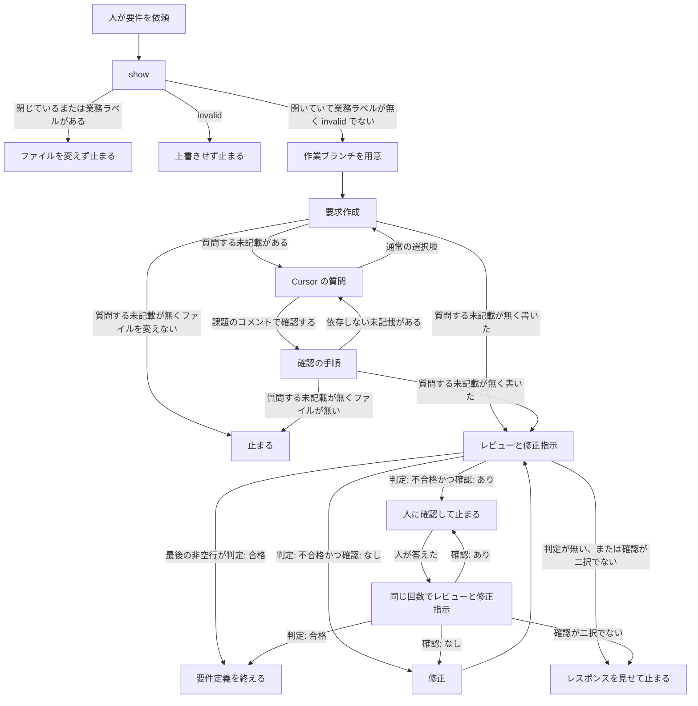
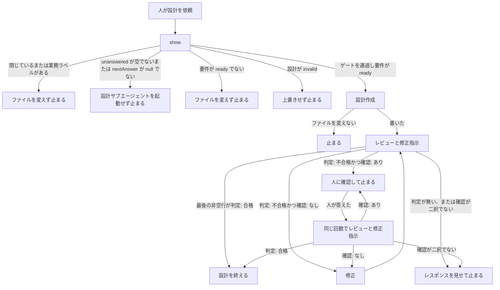
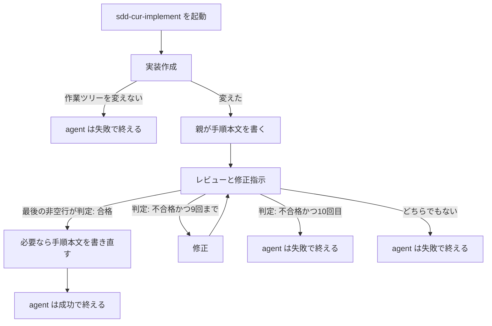

# 30 SDDのモデル実行順の改善

対象は [Issue #30](https://github.com/paterapatera/sdd-cur/issues/30)。要求（#20）、設計（#21）、実装（#22）のレビュー周りを、作成、レビューと修正指示、修正の三段にする。修正案作成役は廃止し、起動しない。手順は、要求と設計が SDD スキル、実装が実装のスキルである。

## 受け入れ条件

- 要求、設計、実装は、同じ実行順、同じモデル割当、同じ統合方針である。違いは、要件が書く確認の有無と、実装の 10 回打ち切りだけである。
- 実行順は、レビューに入る前の初回の成果物作成を 1 回、続けてレビューと修正指示を 1 回の起動、合格なら終了、不合格なら修正のあと再びレビューと修正指示、である。合格のときは修正を起動しない。
- 修正案作成役は廃止する。起動しない。レビュー役が、レビューと修正指示を 1 回の起動で出す。
- 作成のモデルは grok-4.7-high である。「作成から合格まで 1 回」および high の作成 1 回は、レビューに入る前の初回の成果物作成（grok-4.7-high）を指す。設計 26 の質問で人が通常の選択肢を選んだあとの要求作成役の再起動は、同じ要求の続きであり、作成の high の 2 回目に数えない。レビューの不合格のあとは、作成役を起動しない。不合格のあと、作成はやり直さない。修正のモデルは composer-2.5 である。
- レビューと修正指示は grok-4.7-medium で始める。数えたレビューの不合格が 2 回続いたあと、3 回目から grok-4.7-high である。合格まで high のままである。medium には戻さない。
- 合格と不合格の判定は、既存のレビュー判定を維持する。最後の非空行は `判定: 合格` か `判定: 不合格` である。
- 修正指示は、変える部分の差分だけである。全文は書かない。要求と設計は、直したあとの文の差分である。実装は、パスごとの変更箇所と、変更後コードの差分である。
- 要求と設計は、合格でも不合格でも、指摘、直す箇所と直したあとの文、判定、人の確認が要るか、の四項目を必ず出す。指摘が無いときは「指摘なし」と明示する。差分が無いときは「差分なし」と明示する。合格のときの判定は `判定: 合格` であり、確認は `確認: なし` である。人の確認が要るかは、従来の「確認: あり」と「確認: なし」と同じ判断である。
- 実装は、合格でも不合格でも、指摘、パスごとの差分、判定を出す。指摘が無いときは「指摘なし」、差分が無いときは「差分なし」と書いてよい。人の確認は出さない。レビュー不合格が 10 回に達したら打ち切る。数えるのはレビューの回数である。10 回目が不合格のときも、修正も次のレビューも起動しない。
- `bun test` は `gh` を起動しない。ホームディレクトリと、実行中の Cursor のスキルおよびサブエージェントは触らない。

## 範囲外

次は作らない。

- 各サブエージェントのプロンプト本文の細部。指摘の観点の箇条書き、見出しと件数の型、差分の記法の見本は、この課題では書き直さない
- ランナーの実装変更。`src/runner.ts`、`src/agent.ts`、`src/run.ts`、`src/cli.ts` は変えない。課題ランナーは、レビューのために別の agent を起動しない
- 要求を作るときの質問と評価スコア（#26）。質問の手順、E1、E2、E3、「決定」節、`reflect` で取り込まない扱いは残す
- 作業ブランチを用意するタイミングと、デフォルトブランチから作業ブランチを作り直さないこと（#27）
- 設計 22 の、受け入れ手順の本文を書くタイミングと、印の行を書かないこと
- 不合格の回数を、ファイル、課題コメント、または agent の再試行のあいだに残すこと
- 宛先に既にある、廃止した三つのファイルを消すこと。`install` は、リストに無いファイルを残す
- 実装の差分で、パスを消す指示。この要件の出力には無い
- 課題の作成とクローズ。ラベルの変更。受け入れ手順の投稿。完了処理
- 人への確認を、お客さまへの確認コメント（`sdd-cur: 確認`）と同じものにすること。既存の確認手順は変えない
- Forgejo、Jira、Backlog
- `src/sdd.ts`、`src/github.ts`、`src/complete.ts`、`src/conventions.ts` の変更
- `docs/plan.md`、`docs/conventions.md`、この課題以外の `design.md` と `requirements.md` の書き換え
- 依存パッケージ。`package.json` の変更

## 決定

| 項目 | 内容 |
|---|---|
| 起動する役 | 流れごとに三つ。作成、レビューと修正指示、修正。下の表 |
| 廃止 | `sdd-cur-req-fix-proposer`、`sdd-cur-design-fix-proposer`、`sdd-cur-implement-fix-proposer`。ファイルを消し、`subagentFileNames` から外す。スキルは名前を書かず、起動しない |
| 起動 | 親がサブエージェント名で起動する。作成と修正は `model` を渡さない。frontmatter の `model` を使う |
| レビューのモデル | 数えた 1 回目と 2 回目は `model` を渡さない。frontmatter は medium のままである。1 回目と 2 回目が続けて不合格のとき、3 回目から親が `model` に `grok-4.7[reasoning_effort=high,fast=false]` を渡す。合格まで渡す。medium には戻さない |
| 数えるレビュー | 作成のあと、および修正のあとに行うレビューと修正指示が 1 回である。作成と修正は数えない。人の確認のあとの再起動は数えない |
| 連続不合格 | 数えるレビューの最後の非空行が `判定: 不合格` のときに 1 増える。合格で流れは終わる。確認のための再起動では増えない |
| ファイルを書く役 | 要求は要求作成役と要求の修正役だけである。設計は設計作成役と設計の修正役だけである。実装は実装作成役と実装の修正役だけである。レビュー役はファイルを変えない。差分はレスポンスに書く |
| 判定 | レビュー役のレスポンスの最後の非空行は `判定: 合格` か `判定: 不合格` である。親はこの一行で合格と不合格を分ける |
| 確認の行 | 要求と設計では、合格でも不合格でも、指摘、直す箇所と直したあとの文、判定、人の確認が要るか、の四項目を必ず出す。判定行より前の非空行の一つが `確認: あり` または `確認: なし` である。指摘が無いときは「指摘なし」、差分が無いときは「差分なし」と明示する。合格のときは、判定は `判定: 合格`、確認は `確認: なし` である |
| 指摘の置き場所 | レビュー役のレスポンスだけである。ファイルにも課題コメントにも書かない |
| 修正指示 | 変える部分の差分だけである。全文は書かない。要求と設計は、直したあとの文である。実装は、パス、変える箇所、変更後のコードである |
| 合格 | 修正を起動しない。作成も起動しない。要求と設計で確認の行が出ていても、その流れを終える |
| 確認: あり | 判定が不合格のとき、修正を起動しない。確認コメントは投稿しない。人が答えるまで、その部分は要求または設計へ書かない。人が答えたあとは、その答えを人が決めた条件として、レビューと修正指示を同じ回数・同じモデルで再び起動する |
| 確認: なし | 判定が不合格のとき、差分だけを修正へ渡す。修正のあと、次の数えるレビューへ進む |
| 実装の確認 | 出さない。`確認: あり` も `確認: なし` も書かない。不合格で打ち切りでないときは、差分だけを修正へ渡す |
| 実装の打ち切り | 数えた不合格が 10 のとき、修正も次のレビューも起動しない。理由は `実装レビューが不合格のまま10回に達した` である。agent は失敗で終える。10 回には medium のレビューと high のレビューの両方が入る |
| 回数の置き場所 | その手順の一回の実行の中だけである。ファイルにも課題コメントにも残さない。実装は、設計 22 のとおり、agent の再試行へ引き継がない |
| コピー | 下の九つを、この順で `subagentFileNames` に置く。宛先、標準出力、ソースが揃わないときの失敗文は、設計 22 のままである |

| 流れ | 作成 | レビューと修正指示 | 修正 |
|---|---|---|---|
| 要求 | `sdd-cur-req-author` | `sdd-cur-req-reviewer` | `sdd-cur-req-fixer` |
| 設計 | `sdd-cur-design-author` | `sdd-cur-design-reviewer` | `sdd-cur-design-fixer` |
| 実装 | `sdd-cur-implement-author` | `sdd-cur-implement-reviewer` | `sdd-cur-implement-fixer` |

| 役割 | ファイル | frontmatter の model | 変えるもの |
|---|---|---|---|
| 要求作成 | `sdd-cur-req-author.md` | `grok-4.7[reasoning_effort=high,fast=false]` | 要求ファイルだけ。この課題ではファイルを変えない |
| 要求のレビューと修正指示 | `sdd-cur-req-reviewer.md` | `grok-4.7[reasoning_effort=medium,fast=false]` | 変えない。差分はレスポンス |
| 要求の修正 | `sdd-cur-req-fixer.md` | `composer-2.5[fast=false]` | 要求ファイルだけ |
| 設計作成 | `sdd-cur-design-author.md` | `grok-4.7[reasoning_effort=high,fast=false]` | 設計ファイルだけ。この課題ではファイルを変えない |
| 設計のレビューと修正指示 | `sdd-cur-design-reviewer.md` | `grok-4.7[reasoning_effort=medium,fast=false]` | 変えない。差分はレスポンス |
| 設計の修正 | `sdd-cur-design-fixer.md` | `composer-2.5[fast=false]` | 設計ファイルだけ |
| 実装作成 | `sdd-cur-implement-author.md` | `grok-4.7[reasoning_effort=high,fast=false]` | 実装だけ。この課題ではファイルを変えない |
| 実装のレビューと修正指示 | `sdd-cur-implement-reviewer.md` | `grok-4.7[reasoning_effort=medium,fast=false]` | 変えない。差分はレスポンス |
| 実装の修正 | `sdd-cur-implement-fixer.md` | `composer-2.5[fast=false]` | 実装だけ |

人の言葉でのモデル名は、作成が grok-4.7-high、レビューの開始が grok-4.7-medium、3 回目からのレビューが grok-4.7-high、修正が composer-2.5 である。fast はすべて false であり、上の frontmatter と同じ指定である。3 回目から渡す文字列は、作成役の frontmatter の `model` と一文字も違わない。

| 数えた回数 | レビューのモデル | 不合格のとき |
|---|---|---|
| 1 と 2 | medium。`model` は渡さない | 要求と設計は確認の行で分岐する。実装は、9 回までなら差分を修正へ渡す |
| 3 以降 | high を渡す。合格まで戻さない | 要求と設計は合格まで繰り返す。実装は 9 回まで修正へ渡し、10 回目は打ち切る |

「作成から合格まで 1 回」および high の作成 1 回は、レビューに入る前の初回の成果物作成（grok-4.7-high）を指す。設計 26 の質問で人が通常の選択肢を選んだあとの要求作成役の再起動は、同じ要求の続きであり、作成の high の 2 回目に数えない。レビューの不合格のあと、作成役は起動しない。

## サブエージェント

残すファイルのフロントマターは、`name`、`description`、`model` の順である。レビュー役は、その次に `readonly: true` を持つ。`name` と `model` は決定の表と一文字も違わない。

本文は日本語である。どの役も、課題を作らない。課題を閉じない。ラベルを変えない。`gh` を直接起動しない。受け入れ手順を投稿しない。完了処理をしない。確認コメントを投稿しない。

指摘の観点の箇条書きは、要求が設計 20 と設計 26、設計が設計 21、実装が設計 22 のままである。この課題で書き直さない。

### レビューと修正指示

作成が成果を書いたあと、および修正が成果を書いたあとに起動する。作成が成果を変えないで止まったときは、起動しない。

ファイルは変えない。指摘と差分はレスポンスだけである。修正指示は、変える部分の差分だけである。全文は書かない。

最後の非空行は、指摘が無いときは `判定: 合格`、指摘が一つでもあるときは `判定: 不合格` である。「指摘なし」は、指摘が無いことの明示であり、指摘が一つあることには数えない。この二行以外を最後の非空行にしない。

要求と設計は、合格でも不合格でも、指摘、直す箇所と直したあとの文、判定、人の確認が要るか、の四項目を必ず出す。指摘が無いときは「指摘なし」と明示する。差分が無いときは「差分なし」と明示する。合格のときは、判定は `判定: 合格`、確認は `確認: なし` である。判定行より前に、次のどちらか一行を書く。

- 課題、計画、要件、人がその依頼で決めた条件から読めない点があるときは、その点を列挙し、`確認: あり`
- 読めない点が無いときは、`確認: なし` と書く。直す箇所があるときは、直したあとの文の差分を書く。差分が無いときは「差分なし」と明示する

判断は、従来の修正案作成役の「確認: あり」と「確認: なし」と同じである。

実装は、合格でも不合格でも、指摘、パスごとの差分、判定を出す。指摘が無いときは「指摘なし」、差分が無いときは「差分なし」と書いてよい。不合格で直す箇所があるときは、判定行より前に、パスごとの変える箇所と、変更後コードの差分を書く。人の確認は出さない。`確認: あり` も `確認: なし` も書かない。

### 修正

要求と設計では、レビューの確認の行が `確認: なし` のときだけ起動する。渡された差分だけを、その課題の要求ファイルまたは設計ファイルへ反映する。差分に無い文は足さない。差分に無い文は消さない。正しい見出しは、差分が見出しの変更を明示したときだけ変える。

要求の修正は、設計 26 のとおり、レビューに入る前に人が選んだ通常の回答を、人が決めた条件として「決定」節へ書く。差分にその決定が無くても書く。質問のスコアは書かない。

設計の修正は、要求ファイルを変えない。

実装では、不合格であり、数えた回数が 9 以下のときだけ起動する。渡されたパスごとの差分だけを作業ツリーへ反映する。差分に書かれた箇所だけを変える。差分に無いパスは変えない。ファイル全文への置き換えはしない。要求ファイルと設計ファイルは変えない。手順ファイルは変えない。人に確認しない。

### 廃止するファイル

次の三つは消す。

- `agents/sdd-cur-req-fix-proposer.md`
- `agents/sdd-cur-design-fix-proposer.md`
- `agents/sdd-cur-implement-fix-proposer.md`

## スキルの手順

着手、確認、回答、禁止は変えない。設計 26 の質問と、設計 27 の作業ブランチは残す。変えるのは、レビューと修正の段である。

### 要件

`skills/sdd-cur/SKILL.md` の「要件」だけを、次に合わせる。

サブエージェントは `sdd-cur-req-author`、`sdd-cur-req-reviewer`、`sdd-cur-req-fixer` の名前で起動する。作成と修正は model を渡さない。

レビューに入る前の質問、作業ブランチ、`show` の止まり、合格のあとの `show` と「判定が合格なら設計に進むことができる」は、今の手順のままである。

- 数えるレビューは、ファイルを書いたあとの最初と、修正のあとである。開始時の連続不合格は 0 である。ファイルにも課題コメントにも残さない。
- 1 回目と 2 回目は model を渡さない。1 回目と 2 回目が続けて不合格のとき、3 回目から model に `grok-4.7[reasoning_effort=high,fast=false]` を渡す。合格まで渡す。
- 最後の非空行が `判定: 合格` のときは、確認の行が出ていても、修正を起動しない。作成も起動しない。
- 最後の非空行が `判定: 不合格` のときは、連続不合格を 1 増やす。判定行より前が `確認: あり` のときは、列挙された点を人に見せ、修正を起動しない。確認コメントは、この止まりでは投稿しない。人が答えるまで、その部分は要求へ書かない。人が答えたあとは、その答えを人が決めた条件として、レビューと修正指示を再び起動する。この再起動は回数を増やさない。モデルは、その回数と同じものを使う。この止まりは、採点付きの質問とは別である。
- 判定行より前が `確認: なし` のときは、その差分だけを修正へ渡す。あわせて、レビューに入る前に人が選んだ通常の回答を、人が決めた条件として渡す。修正のあと、レビューと修正指示に戻る。
- 最後の非空行が合格と不合格のどちらでもないとき、および不合格なのに確認の行が二択のどちらでもないときは、修正を起動しない。レスポンスを人に見せて止まる。
- 「作成から合格まで 1 回」および high の作成 1 回は、レビューに入る前の初回の成果物作成（grok-4.7-high）を指す。設計 26 の質問で人が通常の選択肢を選んだあとの要求作成役の再起動は、同じ要求の続きであり、作成の high の 2 回目に数えない。レビューの不合格のあと、要求作成役は起動しない。

### 設計

`skills/sdd-cur/SKILL.md` の「設計」だけを、次に合わせる。「要件」と同じモデルと、同じ確認の分岐である。

サブエージェントは `sdd-cur-design-author`、`sdd-cur-design-reviewer`、`sdd-cur-design-fixer` の名前で起動する。作成と修正は model を渡さない。

`show` の止まり、未回答と未反映のゲート、要件が `ready` でないときの止まり、設計が `invalid` のときの上書き禁止、同じ作業ブランチ、合格のあと「判定が合格なら実装依頼に進むことができる」、push と「実装依頼」は人が行う、は今の手順のままである。

- 回数、モデル、`確認: あり`、`確認: なし`、二択でないときの止まりは、要件の手順と同じである。人が答えるまで、その部分は設計へ書かない。
- 合格のときは、確認の行が出ていても、修正を起動しない。要求ファイルはこの手順で作らない。課題は閉じない。
- 不合格のあと、設計作成役は起動しない。

### 実装

`skills/sdd-cur-implement/SKILL.md` のフロントマター、`## 実装` の作成と手順本文、`## 禁止` は残す。`## レビュー` を、次に合わせる。`skills/sdd-cur/SKILL.md` の実装手順は足さない。

サブエージェントは、次の三つを名前で起動する。作成と修正は model を渡さない。frontmatter の `model` を使う。

- `sdd-cur-implement-author`
- `sdd-cur-implement-reviewer`
- `sdd-cur-implement-fixer`

課題ランナーは、レビューのために別の agent を起動しない。人がこのスキルを直接依頼したときも、課題ランナーが起動したときも、同じ手順である。

- 不合格の回数は、この一回の agent 起動の中だけで数える。開始時は 0 である。最後の非空行が `判定: 不合格` のときに 1 増やす。ファイルにも課題コメントにも残さない。
- 1 回目と 2 回目は model を渡さない。1 回目と 2 回目が続けて不合格のとき、3 回目から model に `grok-4.7[reasoning_effort=high,fast=false]` を渡す。合格まで渡す。10 回目も、その回が 3 以上なら high を渡してから判定を見る。
- 最後の非空行が `判定: 合格` のときは、修正を起動しない。手順本文の書き直しは、設計 22 のままである。
- 増やした回数が 9 以下のときは、人に確認しない。差分だけを修正へ渡す。修正のあと、レビューと修正指示に戻る。
- 増やした回数が 10 のときは、修正も次のレビューも起動しない。理由は `実装レビューが不合格のまま10回に達した` である。agent は失敗で終える。
- 最後の非空行が合格と不合格のどちらでもないときは、修正を起動しない。理由は `レビューの判定がありません` である。agent は失敗で終える。
- 実装作成が作業ツリーを変えないで止まったときの理由 `実装作成が作業ツリーを変えませんでした` と、失敗の理由の書き方は、設計 22 のままである。
- `修正案を適用できません` では終わらない。不合格で打ち切りでないときは、差分を修正へ渡す。
- 不合格のあと、実装作成役は起動しない。

## install

`src/install.ts` の `subagentFileNames` を、次の九つに変える。この順である。

1. `sdd-cur-req-author.md`
2. `sdd-cur-req-reviewer.md`
3. `sdd-cur-req-fixer.md`
4. `sdd-cur-design-author.md`
5. `sdd-cur-design-reviewer.md`
6. `sdd-cur-design-fixer.md`
7. `sdd-cur-implement-author.md`
8. `sdd-cur-implement-reviewer.md`
9. `sdd-cur-implement-fixer.md`

`assertSubagentSourceFiles` と `installAgents` は、このリストを見る。九つのいずれかが無いときは、今と同じ失敗である。無いときは `サブエージェントがありません: agents/<名前>.md` である。ディレクトリのときは `サブエージェントではありません: agents/<名前>.md` である。この失敗のときは、スキルもサブエージェントもコピーしない。

コピーはリストの順である。同名があるときは、パッケージ側の内容に置き換える。宛先にある、この九つ以外のファイルは残す。廃止した三つが宛先に残っていても、この課題では消さない。

宛先の解決、スキルのコピー、標準出力、`src/cli.ts` の `cmdInstall` は変えない。

## テスト

`bun test` で実行する。一時ディレクトリを使い、終わったら消す。

`src/agents.test.ts` は、九つの `name` と `model` が決定の表と一致することを確かめる。三つの修正案作成役の期待は外す。`agents/` に三つのファイルが無いことを確かめる。

- 要求のレビュー役の本文に `判定: 合格`、`判定: 不合格`、`確認: あり`、`確認: なし`、`全文は書かない`、`E1`、`E2`、`E3` がある。
- 設計のレビュー役の本文に `判定: 合格`、`判定: 不合格`、`確認: あり`、`確認: なし`、`全文は書かない` がある。
- 実装のレビュー役の本文に `判定: 合格`、`判定: 不合格`、`全文は書かない`、`人に確認しない` がある。`確認: あり` は無い。
- 要求の修正役の本文に `人が決めた条件`、`決定`、`質問のスコアは書かない`、`差分` がある。
- 設計の修正役と実装の修正役の本文に `差分` がある。実装の修正役の本文に `人に確認しない` がある。

`src/install.test.ts` は、`subagentFileNames` に追従する。テスト名の十二は、九に変える。九つのいずれかが無いときは失敗し、スキルの宛先もサブエージェントの宛先も作られない。三つの廃止名は `subagentFileNames` に無い。

`src/sdd.test.ts` の、`skills/sdd-cur/SKILL.md` の必須文言は、設計 26 と設計 27 の分を残す。三つの修正案作成役の名前は、必須から外し、本文に無いことを確かめる。残す名前は、要求の三つと設計の三つである。加えて、`model は渡さない`、`判定: 合格`、`判定: 不合格`、`確認: あり`、`確認: なし`、`指摘はどこにも置かない`、`判定が合格なら設計に進むことができる`、`判定が合格なら実装依頼に進むことができる`、`人が答えるまで`、`3回目`、`grok-4.7[reasoning_effort=high,fast=false]`、`全文は書かない` が含まれる。install が `subagentFileNames` の全ファイルをパッケージと見比べる確認は残す。

`src/runner.test.ts` の `skills/sdd-cur-implement/SKILL.md` の確認は、設計 6 のフロントマターと、設計 22 の禁止の文言を残す。`sdd-cur-implement-fix-proposer` は必須から外し、本文に無いことを確かめる。`確認: なし` は必須から外し、本文に無いことを確かめる。残すのは、`## レビュー`、三つの実装用サブエージェント名、`model は渡さない`、`判定: 合格`、`判定: 不合格`、`指摘はどこにも置かない`、`人に確認しない`、`全文は書かない`、`3回目`、`grok-4.7[reasoning_effort=high,fast=false]`、`実装レビューが不合格のまま10回に達した`、`レビューの判定がありません`、`別の agent を起動しない` である。

## 作業の一覧

1. 三つの修正案作成役のファイルを消す。レビュー役三つと修正役三つを、上の契約に合わせる。作成役三つは変えない。`src/agents.test.ts` を通す。
2. `src/install.ts` の `subagentFileNames` を九つにする。無いときの失敗と、廃止名がリストに無いことを、関数テストで確かめる。
3. `skills/sdd-cur/SKILL.md` の「要件」と「設計」、および `skills/sdd-cur-implement/SKILL.md` の「レビュー」を、上の手順に変える。質問、作業ブランチ、手順本文、禁止は残す。
4. `src/sdd.test.ts` と `src/runner.test.ts` の必須文言を、上のテストに合わせる。
5. README の `install` の説明を、`agents/<名前>.md` の九つをコピーする、に変える。
6. 一時ディレクトリへの `install` で、スキルと九つのサブエージェントがコピーされることを確かめる。