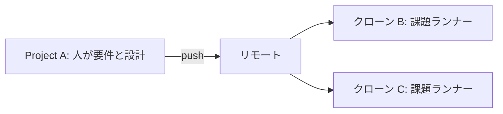
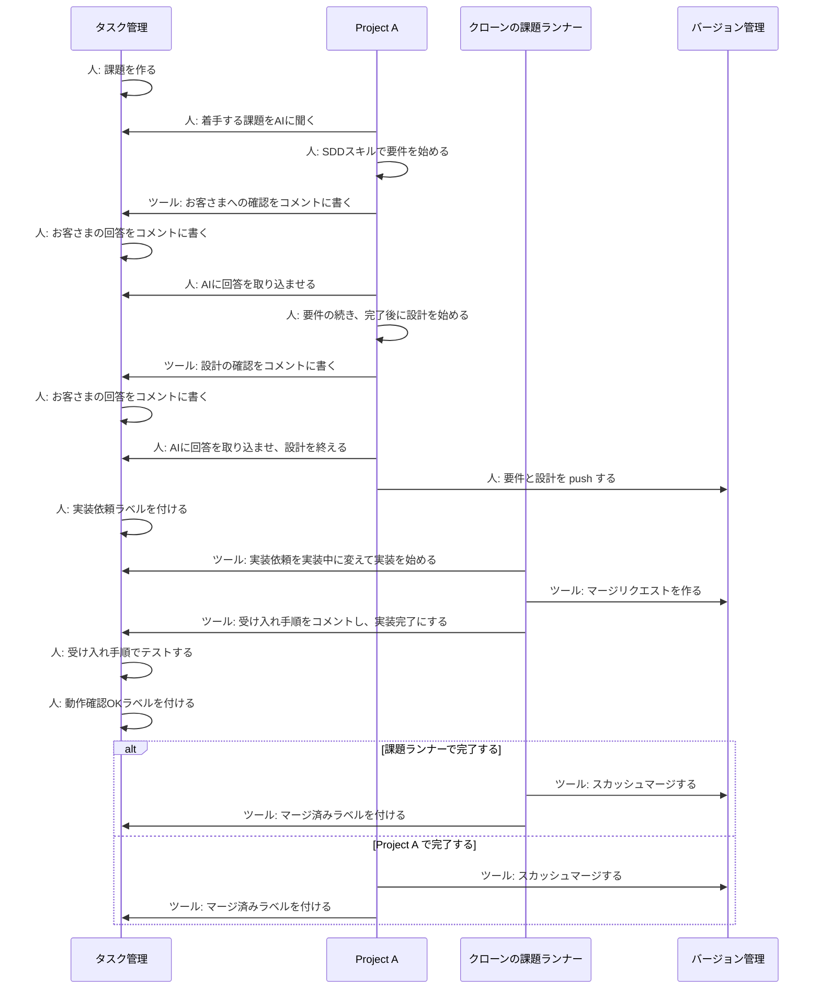

# 計画

このプロジェクト専用の SDD スキルと課題ランナーを作る。汎用の SDD にはしない。課題の作成、要件、設計、お客さまへの確認は人が Cursor で行う。実装と、選んだ場合の完了処理は、課題ランナーが別のクローンで行う。

## 対応するサービス

| 役割 | サービス | 順 |
|---|---|---|
| タスク管理 | GitHub の Issue | 最初 |
| バージョン管理 | GitHub | 最初 |
| タスク管理とバージョン管理 | Forgejo | 2番目 |
| タスク管理 | Jira | 3番目 |
| タスク管理 | Backlog | 4番目 |

最初の GitHub Issue と GitHub で、このプロジェクト自身の開発を進める。Jira と Backlog は課題だけを受け持ち、マージリクエストは GitHub か Forgejo に置く。

## 作るもの

| もの | 動く場所 | 役割 |
|---|---|---|
| SDD スキル | 人が開いている Project A の Cursor | 着手する課題の提案、要件、設計、回答の取り込み、完了処理 |
| 課題ランナー | Project A をクローンしたディレクトリ | 「実装依頼」の実装、「動作確認OK」の完了処理 |
| タスク管理への接続 | スキルとランナーの両方 | 課題の取得、コメント、ラベル |
| バージョン管理への接続 | スキルとランナーの両方 | ブランチ、マージリクエスト、スカッシュマージ |

課題を作るのは人である。課題ランナーも SDD スキルも、課題は作らない。

SDD スキルが知るのは、この計画のラベル、確認コメント、回答の取り込み、課題ランナーとの境界である。他のプロジェクトへ持ち出すための汎用手続きにはしない。

## 配布と実行

SDD スキルと課題ランナーは、一つのパッケージ `@paterapatera/sdd-cur` にする。入口は二つである。

| コマンド | 動かす場所 | すること |
|---|---|---|
| `bunx @paterapatera/sdd-cur install` | 任意。指定したときはプロジェクト | 既定では `~/.cursor/skills`。指定があるときは、そのプロジェクトの `.cursor/skills` |
| `bunx @paterapatera/sdd-cur run` | クローン B や C | 課題ランナーをそのディレクトリで実行する |

`install` の既定の置き場所は `~/.cursor/skills` である。指定があるときは、そのプロジェクトの `.cursor/skills` に置く。Cursor は、このどちらの `skills` も読む。

`run` は、明示的に閉じるまで動き続ける。課題をポーリングし、処理し、処理が終わったら再びポーリングを始める。処理のあいだは次の課題を取らない。

パッケージ内の実行ファイル名は `sdd-cur` にする。パスへ入ったあとは `sdd-cur install` と `sdd-cur run` で呼ぶ。

`bunx` が行うのは、パッケージの取得とプロセスの起動である。要件と設計のスキルは、Project A の Cursor が読む。課題ランナーはクローンの中で動き、「実装依頼」を「実装中」に変えてから、そのクローンで実装のスキルを Cursor に実行させる。B と C は別プロセスなので、同時に別の課題を実装できる。

このプロジェクト自身を開発しているあいだは、このリポジトリの同じ入口を `bun` で直接実行する。公開したあとの B と C は `bunx` に切り替える。

## 要件と設計

要件と設計は `docs/specs` に置く。人が Project A の Cursor で書き、リモートへ push してから「実装依頼」を付ける。クローンは `docs/specs` を読んで実装する。

## ディレクトリ

人は Project A で要件と設計を行う。課題ランナーは Project A の作業ディレクトリでは動かさない。

課題ランナーは、Project A をクローンしたディレクトリで動かす。クローンは複数でよく、たとえば B と C を同時に動かす。B と C は別の課題を同時に実装できる。

同じ課題を二つのクローンが実装しない。実装を始めるクローンは、「実装依頼」を外して「実装中」を付ける。「実装中」の課題は、他のクローンの探索対象から外れる。

人が Project A で書いた `docs/specs` は、リモートへ push してから「実装依頼」を付ける。クローンは、その push を含むリモートからブランチを作る。

## ラベル

| ラベル | 付ける主体 | 意味 |
|---|---|---|
| 実装依頼 | 人 | 設計が終わり、実装してよい |
| 実装中 | 課題ランナー | 実装を始めた |
| 実装完了 | 課題ランナー | 実装が終わり、受け入れ手順がコメントにある |
| 動作確認OK | 人 | 受け入れテストに合格した |
| マージ済み | 完了処理 | スカッシュマージと同時に付ける |

ラベルは「実装依頼」→「実装中」→「実装完了」→「動作確認OK」→「マージ済み」の順に進む。課題は閉じない。お客さまの確認が取れてから、人が閉じる。

完了処理は一つにする。呼ぶ場所は、課題ランナーと、Cursor の SDD スキルの二つである。すでにマージ済みのマージリクエストは、もう一度マージしない。残っている「マージ済み」ラベルだけを揃える。

## 業務フロー

1. 人が、タスク管理システムに課題を作る。
2. 人が Project A の Cursor で、AI にどの課題から着手するかを聞く。決めるのは人である。
3. 人が、SDD スキルで要件の作成を始める。
4. 要件のうち、その場で決められない点は、後日お客さまに確認する。AI が確認内容を、その課題のコメントに書く。
5. 人が、お客さまの回答を、その課題のコメントに書く。
6. 人が AI に回答を取り込ませ、要件の続きをする。
7. 要件が完了したら、人が SDD スキルで設計を始める。
8. お客さまの判断が必要な設計事項は、AI が確認内容を、その課題のコメントに書く。
9. 人が、お客さまの回答を、その課題のコメントに書く。
10. 人が AI に回答を取り込ませ、設計の続きをする。
11. 人が要件と設計を push し、課題に「実装依頼」ラベルを付ける。
12. クローン上の課題ランナーが課題をポーリングする。「実装依頼」があれば「実装中」に変えて実装を始める。実装が終わると、再びポーリングを始める。
13. 実装が完了したら、課題ランナーが受け入れ手順を課題のコメントに書き、ラベルを「実装完了」に変える。
14. 人が「実装完了」を確認し、コメントの受け入れ手順で受け入れテストをする。
15. 合格したら、人が「動作確認OK」を付ける。完了処理は次のどちらか一つが行う。
    - 課題ランナーが「動作確認OK」を見て行う。
    - 人が Project A の Cursor で、SDD スキルから行う。
16. 完了処理は、マージリクエストのスカッシュマージと「マージ済み」ラベルの付与である。課題は閉じない。お客さまの確認が取れてから、人が閉じる。

## 確認コメントと回答

確認は、要件と設計のどちらも、課題のコメントだけに書く。バージョン管理側には書かない。

確認コメントを一つ書くたびに、対応する回答コメントを人が一つ書く。AI が取り込むのは、まだ要件または設計に反映していない回答コメントである。

お客さまは、このツールの利用者ではない。回答を課題に書くのは人である。

## 実装の範囲

課題ランナーが行う実装は、ラベルが「実装依頼」の課題だけである。要件と設計の途中の課題は、ランナーが実装しない。

実装の結果はマージリクエストにする。受け入れテストのあいだ、マージリクエストは開いたままにする。スカッシュマージは完了処理だけが行う。

## 作る順序

1. パッケージ `@paterapatera/sdd-cur` の入口を作る。`install` の既定は `~/.cursor/skills` で、指定があるときはプロジェクトの `.cursor/skills` に置く。`run` は、明示的に閉じるまで、ポーリング、処理、処理後の再ポーリングを繰り返す。あわせて GitHub Issue と GitHub への接続を作る。課題の取得、コメント、ラベル、ブランチ、マージリクエスト、スカッシュマージを、スキルとランナーの両方から呼べるようにする。
2. このプロジェクトの要件と設計の SDD スキルを作る。成果は `docs/specs` に置く。確認コメントの作成と、回答コメントの取り込みを含める。`install` で置けるようにする。
3. 課題ランナーを作る。Project A のクローンで `run` を動かし、「実装依頼」を「実装中」に変えてから、そのクローンで実装のスキルを Cursor に実行させる。受け入れ手順のコメントと「実装完了」までを行う。B と C の二つのクローンで、別の課題を同時に進められることを確かめる。
4. 完了処理を一つ作り、クローンの「動作確認OK」と、Project A の完了スキルの両方から呼ぶ。スカッシュマージと「マージ済み」までを行い、課題は閉じない。
5. この 1 から 4 を、GitHub Issue と GitHub だけで、このプロジェクト自身の開発に使う。
6. 対応を Forgejo、Jira、Backlog の順に広げる。

## 未決

- 受け入れテストが不合格のとき、ラベルを何にし、課題ランナーが直すのか、Project A の Cursor で直すのか。
- 一つのプロジェクトで、完了処理を課題ランナーと Cursor のどちらから呼ぶか。両方を同時に有効にはしない。
