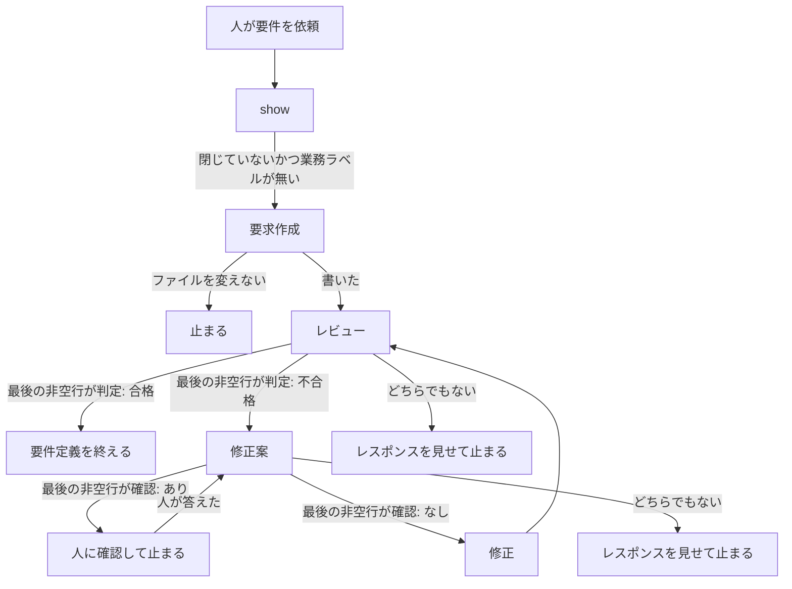

# 20 要求作成後にレビューと指摘をする

対象は [Issue #20](https://github.com/paterapatera/sdd-cur/issues/20)。要求を作ったあとに、要求のレビューとレビュー指摘をする。手順は SDD スキルが行い、四つのサブエージェントは `install` がコピーする。

## 受け入れ条件

- 人が要件を依頼したあと、要求作成、レビューの順でサブエージェントが動く。不合格のときだけ修正案と修正をし、レビューに戻る。合格のときは要件定義を終え、設計に進める。
- レビューの指摘は、レビュー役のレスポンスだけである。ファイルにも課題コメントにも残さない。
- `install` が、パッケージ内 `agents/<名前>.md` を、引数を省くと `~/.cursor/agents/<名前>.md`、プロジェクトのルートを渡すと `<root>/.cursor/agents/<名前>.md` へコピーする。
- `bun test` は `gh` を起動しない。ホームディレクトリと、実行中の Cursor のスキルおよびサブエージェントは触らない。

## 範囲外

次は作らない。

- 設計を作ったあとの設計のレビューとレビュー指摘（#21）
- 実装のあとの実装のレビューとレビュー指摘（#22）
- 要求を作るとき、課題に書いていない部分を人へ質問し、選択肢に評価スコアを添えること（#26）
- マージ時のブランチ削除（#18）
- 使いたくないプロジェクトでスキルを止めること（#19）
- 変えた仕様の巻き戻り防止（#23）
- ランナーのアサイン対象（#24）
- `sdd-cur.completion` の廃止（#25）
- 課題の作成とクローズ。ラベルの変更。実装。受け入れ手順。完了処理
- 人への確認を、お客さまへの確認コメント（`sdd-cur: 確認`）と同じものにすること。この設計では決めない。既存の確認手順は変えない
- レビューのレスポンスの、判定行以外の見出しと件数の型
- Forgejo、Jira、Backlog
- `src/run.ts`、`src/runner.ts`、`src/sdd.ts`、`src/github.ts`、`src/complete.ts`、`src/conventions.ts` の変更
- `docs/plan.md`、`docs/conventions.md`、課題 1〜7 の `design.md` の書き換え
- 依存パッケージ。`package.json` の変更

## 決定

| 項目 | 内容 |
|---|---|
| サブエージェント | パッケージ内 `agents/` の四つのファイル。`install` がコピーする。スキルディレクトリの下には置かない |
| 起動 | SDD スキルが、サブエージェント名で起動する。`model` は渡さない。frontmatter の `model` を使う |
| 要求のファイルを書く役 | 要求作成役と修正役だけである。親と、レビュー役と、修正案役は要求ファイルを変えない |
| 指摘の置き場所 | レビュー役のレスポンスだけである。ファイルにも課題コメントにも書かない |
| 判定 | レビュー役のレスポンスの最後の非空行は `判定: 合格` か `判定: 不合格` である。親はこの一行だけで分岐する |
| 合格 | 修正案役も修正役も起動しない。要件定義は完了である。設計ファイルは作らない。課題は閉じない。設計に進めると人に伝える |
| 不合格 | 修正案、修正、レビューの順に戻る。合格になるまで繰り返す |
| 読めない部分 | 課題、計画、人がその依頼で決めた条件から読めない部分は、要求へ書かない。人が答えるまで修正役を起動しない |
| コピー元 | `agents/<名前>.md`。`<名前>` は下の表のファイル列である |
| コピー先 | 引数を省くと `~/.cursor/agents/<名前>.md`。プロジェクトのルートを渡すと `<root>/.cursor/agents/<名前>.md` |
| スキルのコピー | 設計 1 のままである。パッケージ内 `skills/` 直下を、引数なしなら `~/.cursor/skills`、プロジェクト指定なら `<root>/.cursor/skills` へコピーする |
| 標準出力 | 設計 1 のままである。スキルの宛先を先に書く。サブエージェントの宛先は書かない |
| 失敗 | 理由は日本語の一行である。四つのコピー元が揃わないときは、スキルもサブエージェントもコピーしない |

| 役割 | ファイル | サブエージェント名 | frontmatter の model | ファイルを変える |
|---|---|---|---|---|
| 要求作成 | `sdd-cur-req-author.md` | `sdd-cur-req-author` | `grok-4.7[reasoning_effort=high,fast=false]` | 要求ファイルだけ |
| レビュー | `sdd-cur-req-reviewer.md` | `sdd-cur-req-reviewer` | `grok-4.7[reasoning_effort=medium,fast=false]` | 変えない |
| レビュー指摘の修正案作成 | `sdd-cur-req-fix-proposer.md` | `sdd-cur-req-fix-proposer` | `grok-4.7[reasoning_effort=high,fast=false]` | 変えない |
| 修正 | `sdd-cur-req-fixer.md` | `sdd-cur-req-fixer` | `composer-2.5[fast=false]` | 要求ファイルだけ |

人の言葉でのモデル名は、要求作成と修正案作成が grok-4.7-high、レビューが grok-4.7-medium、修正が composer-2.5 である。fast はすべて false であり、上の frontmatter の `model` と同じ一つの指定である。

## サブエージェント

各ファイルの最初のフロントマターは、`name`、`description`、`model` をこの順で持つ。レビュー役と修正案役は、その次に `readonly: true` を持つ。`name` はサブエージェント名と一文字も違わない。`model` は上の表と一文字も違わない。

本文は日本語である。どの役も、課題を作らない。課題を閉じない。ラベルを変えない。実装しない。コミットしない。`gh` を直接起動しない。受け入れ手順を投稿しない。完了処理をしない。確認コメントを投稿しない。設計ファイルを作らない。

### 要求作成

人が要件を依頼したとき、最初に一度だけ起動する。

- `show` の状態が `missing` のときは、課題の題で最初の見出しを作る。見出しは `# <番号> <題>` であり、題は課題の題と一文字も違わない。
- `invalid` のときは上書きしない。
- `ready` のときは、既存の正しい見出しは変えない。本文を続ける。
- 書いてよい挙動は、対象課題、計画、人がその依頼で決めた条件だけである。読めない点はファイルへ書かず、親への返信に列挙する。

### レビュー

要求作成がファイルを書いたあと、および修正がファイルを書いたあとに起動する。要求作成がファイルを変えないで止まったときは、起動しない。

レビュー役はファイルを変えない。指摘はレスポンスだけである。日本語の常体で、観点ごとの短い評価を書く。指摘があるときだけ、番号付きで、ファイルのどの文がどの根拠に反するかを書く。

最後の非空行は、指摘が無いときは `判定: 合格`、指摘が一つでもあるときは `判定: 不合格` である。この二行以外を最後の非空行にしない。

### 修正案

レビューの最後の非空行が `判定: 不合格` のときだけ起動する。ファイルは変えない。指摘に無い変更は書かない。課題、計画、人が決めた条件に無い仕組みは、決まったこととして書かない。

読めない点があるときは、その点を本文に列挙する。最後の非空行は `確認: あり` である。読めない点が無いときは、修正役がそのまま適用できる変更後の要求全文を書き、最後の非空行は `確認: なし` である。

### 修正

修正案の最後の非空行が `確認: なし` のときだけ起動する。渡された修正案だけを、その課題の要求ファイルへ反映する。正しい見出しは、修正案が見出しの変更を明示したときだけ変える。設計ファイルは変えない。

## スキルの手順

`skills/sdd-cur/SKILL.md` の「要件」を、次の手順に変える。着手、設計、確認、回答、禁止は、この課題では変えない。既存の必須文言は残す。

人が要件を依頼したときは、先に `bun src/cli.ts show <番号>` を実行する。`state` が `open` でないとき、および業務ラベルが一つでもあるときは、これまでどおり止まり、ファイルを変えず、サブエージェントも起動しない。

要件の状態が `invalid` のときは上書きしない。サブエージェントは起動しない。`missing` と `ready` の見出しの扱いは、要求作成役に渡す。親は要求ファイルを自分では書かない。

- サブエージェントは、表の名前で起動する。`model` は渡さない。
- 合格のときは、修正案も修正も起動しない。設計ファイルは作らない。課題は閉じない。判定が合格なら設計に進むことができる、と人に伝えて終わる。設計の手順は、人が設計を依頼したときだけ始める。
- 不合格のときは、修正案を起動する。`確認: あり` のときは、列挙された点を人に見せ、修正を起動しない。確認コメントは、この止まりでは投稿しない。人が答えたあとは、その答えを人が決めた条件として修正案を再び起動する。
- `確認: なし` のときは、その修正案だけを修正へ渡す。修正のあと、レビューに戻る。
- 最後の非空行が、その役の二択のどちらでもないときは、修正案も修正も起動しない。レスポンスを人に見せて止まる。

## install

`src/install.ts` に、サブエージェントのコピーを足す。スキルのコピー関数の引数と、スキル宛先の規則は変えない。

`src/cli.ts` の `cmdInstall` は、`installSkills` を直接呼ばない。代わりに、`src/install.ts` の手順を呼ぶ。手順は、四つのコピー元を確かめてからスキルをコピーし、そのあとサブエージェントをコピーする。

コピー元のディレクトリは、`src/install.ts` から見て `../agents` である。`import.meta.dir` からの相対パスにする。

四つのファイル名は、次の順で一つに定義する。

1. `sdd-cur-req-author.md`
2. `sdd-cur-req-reviewer.md`
3. `sdd-cur-req-fix-proposer.md`
4. `sdd-cur-req-fixer.md`

手順は一列である。途中で失敗したときは、それより後をコピーしない。

1. コピー元の `agents` が存在し、ディレクトリであることを確かめる。失敗の理由は、`assertDirectoryExists` と同じ文である。
2. 四つのファイルが、その順でファイルとして存在することを確かめる。無いときは `サブエージェントがありません: agents/<名前>.md` である。ディレクトリのときは `サブエージェントではありません: agents/<名前>.md` である。
3. ここまでが成功してから、これまでのスキルのコピーを行う。
4. サブエージェントの宛先ディレクトリを再帰的に作る。引数が無いときは `homedir()` に `.cursor/agents` を足す。引数が一つあるときは、`path.resolve` したプロジェクトのルートに `.cursor/agents` を足す。引数が `.cursor/agents` で終わっていても、さらに `.cursor/agents` を足す。
5. 四つのファイルを、その順で宛先の同じファイル名へコピーする。同名があるときは、パッケージ側の内容に置き換える。宛先にある、この四つ以外のファイルは残す。

1 または 2 で失敗したときは、スキルもサブエージェントもコピーしない。終了コードは 1 である。使い方は書かない。

標準出力は、スキルのコピーが成功したときの設計 1 のままである。最初の行はスキルの宛先の絶対パスである。コピーしたスキル名が無いときは、次の行が「配置するスキルはありません」である。サブエージェントの宛先は書かない。

## テスト

`bun test` で実行する。一時ディレクトリを使い、終わったら消す。

`install` は関数を直接呼ぶ。

- 引数なしのサブエージェントの宛先が、渡したホームに `.cursor/agents` を足したパスである。
- プロジェクトのルートを渡すと、`<root>/.cursor/agents` になる。
- 一時ディレクトリ上の `agents/` から、四つのファイルがコピーされる。中身はコピー元と一致する。
- 宛先に既にある、四つ以外のファイルは残る。
- 同名のファイルは、パッケージ側の内容に置き換わる。
- 四つのいずれかが無いときは失敗し、スキルの宛先もサブエージェントの宛先も作られない。これは、`cmdInstall` が呼ぶのと同じ手順を関数として直接呼んで確かめる。
- スキルの既存のテストは、これまでどおり成功する。

起動の確認は、一時ディレクトリを使った子プロセスで行う。

- `bun src/cli.ts install <temp>` の終了コードは 0 である。
- `<temp>/.cursor/skills/sdd-cur/SKILL.md` は、パッケージのそのファイルと一致する。
- `<temp>/.cursor/agents/` の四つのファイルは、パッケージの `agents/` の同じ名前と一致する。

`agents/*.md` は、フロントマターの `name` と `model` が決定の表と一致することを確かめる。レビュー役の本文に `判定: 合格` と `判定: 不合格` がある。修正案役の本文に `確認: あり` と `確認: なし` がある。

`skills/sdd-cur/SKILL.md` の既存の必須文言は残す。加えて、四つのサブエージェント名、`model は渡さない`、`判定: 合格`、`判定: 不合格`、`確認: あり`、`確認: なし`、`指摘はどこにも置かない`、`判定が合格なら設計に進むことができる`、`人が答えるまで` が含まれる。

## 実装の順序

1. `agents/` に四つのファイルを書き、フロントマターと判定の文言をテストで確かめる。
2. `src/install.ts` に宛先の解決と、四つのファイルのコピーを足す。`src/cli.ts` の `cmdInstall` は、この手順を呼び、`installSkills` を直接呼ばない。ソースが揃わないときはスキルをコピーしない。関数テストを通す。
3. `skills/sdd-cur/SKILL.md` の「要件」を、上の手順に変える。既存の必須文言は残す。
4. 一時ディレクトリへの `install` で、スキルと四つのサブエージェントがコピーされることを確かめる。
5. README の `install` の説明に、`agents/<名前>.md` もコピーすることを足す。ディレクトリの説明に `agents/` を足す。AGENTS.md の `src/install.ts` の行に、サブエージェントのコピーを足す。
