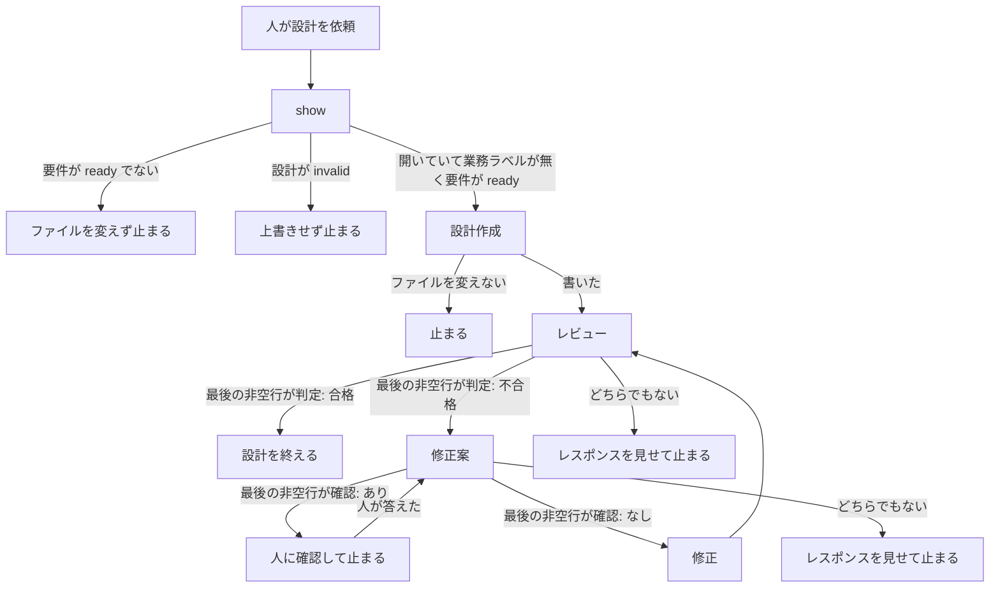

# 21 設計作成後にレビューと指摘をする

対象は [Issue #21](https://github.com/paterapatera/sdd-cur/issues/21)。設計を作ったあとに、設計のレビューとレビュー指摘をする。手順は SDD スキルが行い、四つのサブエージェントは `install` がコピーする。

## 受け入れ条件

- 人が設計を依頼したあと、設計作成、レビューの順でサブエージェントが動く。不合格のときだけ修正案と修正をし、レビューに戻る。合格のときは設計を終え、実装依頼に進める。
- レビューの指摘は、レビュー役のレスポンスだけである。ファイルにも課題コメントにも残さない。
- `install` が、パッケージ内 `agents/<名前>.md` の設計用四つを、既存の要求用四つと同じ宛先へコピーする。引数を省くと `~/.cursor/agents/<名前>.md`、プロジェクトのルートを渡すと `<root>/.cursor/agents/<名前>.md` である。
- `bun test` は `gh` を起動しない。ホームディレクトリと、実行中の Cursor のスキルおよびサブエージェントは触らない。

## 範囲外

次は作らない。

- 要求を作ったあとの要求のレビューとレビュー指摘（#20）。`skills/sdd-cur/SKILL.md` の「要件」と、要求用の四つのサブエージェントは変えない
- 実装のあとの実装のレビューとレビュー指摘（#22）
- 要求を作るとき、課題に書いていない部分を人へ質問し、選択肢に評価スコアを添えること（#26）
- マージ時のブランチ削除（#18）
- 使いたくないプロジェクトでスキルを止めること（#19）
- 変えた仕様の巻き戻り防止（#23）
- ランナーのアサイン対象（#24）
- `sdd-cur.completion` の廃止（#25）
- 課題の作成とクローズ。ラベルの変更。実装。受け入れ手順。完了処理
- 人への確認を、お客さまへの確認コメント（`sdd-cur: 確認`）と同じものにすること。この設計では決めない。既存の確認手順は変えない
- レビューのレスポンスの、判定行以外の見出しと件数の型
- Forgejo、Jira、Backlog
- `src/cli.ts`、`src/run.ts`、`src/runner.ts`、`src/sdd.ts`、`src/github.ts`、`src/complete.ts`、`src/conventions.ts` の変更
- `docs/plan.md`、`docs/conventions.md`、課題 1〜7 と課題 20 の `design.md` の書き換え
- 依存パッケージ。`package.json` の変更

## 決定

| 項目 | 内容 |
|---|---|
| サブエージェント | パッケージ内 `agents/` に、設計用の四つのファイルを足す。`install` が、要求用の四つとあわせてコピーする。スキルディレクトリの下には置かない |
| 起動 | SDD スキルが、サブエージェント名で起動する。`model` は渡さない。frontmatter の `model` を使う |
| 設計のファイルを書く役 | 設計作成役と修正役だけである。親と、レビュー役と、修正案役は設計ファイルを変えない |
| 指摘の置き場所 | レビュー役のレスポンスだけである。ファイルにも課題コメントにも書かない |
| 判定 | レビュー役のレスポンスの最後の非空行は `判定: 合格` か `判定: 不合格` である。親はこの一行だけで分岐する |
| 合格 | 修正案役も修正役も起動しない。設計は完了である。要求ファイルは作らない。課題は閉じない。実装依頼に進めると人に伝える。push と「実装依頼」は人が行う |
| 不合格 | 修正案、修正、レビューの順に戻る。合格になるまで繰り返す |
| 読めない部分 | 課題、計画、要件、人がその依頼で決めた条件から読めない部分は、設計へ書かない。人が答えるまで修正役を起動しない |
| コピー元 | `agents/<名前>.md`。`<名前>` は下の表のファイル列である。要求用の四つは、設計 20 の順のままリストの前に残す |
| コピー先 | 設計 20 のままである。引数を省くと `~/.cursor/agents/<名前>.md`。プロジェクトのルートを渡すと `<root>/.cursor/agents/<名前>.md` |
| スキルのコピー | 設計 1 のままである。パッケージ内 `skills/` 直下を、引数なしなら `~/.cursor/skills`、プロジェクト指定なら `<root>/.cursor/skills` へコピーする |
| 標準出力 | 設計 1 のままである。スキルの宛先を先に書く。サブエージェントの宛先は書かない |
| 失敗 | 理由は日本語の一行である。八つのコピー元のいずれかが揃わないときは、スキルもサブエージェントもコピーしない |

| 役割 | ファイル | サブエージェント名 | frontmatter の model | ファイルを変える |
|---|---|---|---|---|
| 設計作成 | `sdd-cur-design-author.md` | `sdd-cur-design-author` | `grok-4.7[reasoning_effort=high,fast=false]` | 設計ファイルだけ |
| レビュー | `sdd-cur-design-reviewer.md` | `sdd-cur-design-reviewer` | `grok-4.7[reasoning_effort=medium,fast=false]` | 変えない |
| レビュー指摘の修正案作成 | `sdd-cur-design-fix-proposer.md` | `sdd-cur-design-fix-proposer` | `grok-4.7[reasoning_effort=high,fast=false]` | 変えない |
| 修正 | `sdd-cur-design-fixer.md` | `sdd-cur-design-fixer` | `composer-2.5[fast=false]` | 設計ファイルだけ |

人の言葉でのモデル名は、設計作成と修正案作成が grok-4.7-high、レビューが grok-4.7-medium、修正が composer-2.5 である。fast はすべて false であり、上の frontmatter の `model` と同じ一つの指定である。要求のレビュー（#20）の対応する役割と同じである。

## サブエージェント

各ファイルの最初のフロントマターは、`name`、`description`、`model` をこの順で持つ。レビュー役と修正案役は、その次に `readonly: true` を持つ。`name` はサブエージェント名と一文字も違わない。`model` は上の表と一文字も違わない。

本文は日本語である。どの役も、課題を作らない。課題を閉じない。ラベルを変えない。実装しない。コミットしない。`gh` を直接起動しない。受け入れ手順を投稿しない。完了処理をしない。確認コメントを投稿しない。要求ファイルを作らない。要求ファイルは変えない。

### 設計作成

人が設計を依頼したとき、最初に一度だけ起動する。要件の状態が `ready` でないときは、親が起動しない。

- `show` の設計の状態が `missing` のときは、課題の題で最初の見出しを作る。見出しは `# <番号> <題>` であり、題は課題の題と一文字も違わない。
- `invalid` のときは上書きしない。
- `ready` のときは、既存の正しい見出しは変えない。本文を続ける。
- 書いてよい挙動は、対象課題、計画、その課題の要件、人がその依頼で決めた条件だけである。読めない点はファイルへ書かず、親への返信に列挙する。

### レビュー

設計作成がファイルを書いたあと、および修正がファイルを書いたあとに起動する。設計作成がファイルを変えないで止まったときは、起動しない。

レビュー役はファイルを変えない。指摘はレスポンスだけである。日本語の常体で、観点ごとの短い評価を書く。指摘があるときだけ、番号付きで、ファイルのどの文がどの根拠に反するかを書く。

指摘にするのは、次だけである。

- 見出しが課題の題と違う。
- 課題、計画、要件、人が決めた条件に無い挙動が書いてある。
- 要件の受け入れ条件が抜けている。
- 人が決めた条件が抜けている。
- 範囲外にすべき兄弟課題の挙動が、受け入れ条件に入っている。
- 要求ファイルをこの設計の手順で作る、と書いてある。

好み、文体だけの提案、課題に無い仕組みの追加案は、指摘にしない。要求と実装はレビューしない。

最後の非空行は、指摘が無いときは `判定: 合格`、指摘が一つでもあるときは `判定: 不合格` である。この二行以外を最後の非空行にしない。

### 修正案

レビューの最後の非空行が `判定: 不合格` のときだけ起動する。ファイルは変えない。指摘に無い変更は書かない。課題、計画、要件、人が決めた条件に無い仕組みは、決まったこととして書かない。

読めない点があるときは、その点を本文に列挙する。最後の非空行は `確認: あり` である。読めない点が無いときは、修正役がそのまま適用できる変更後の設計全文を書き、最後の非空行は `確認: なし` である。

### 修正

修正案の最後の非空行が `確認: なし` のときだけ起動する。渡された修正案だけを、その課題の設計ファイルへ反映する。正しい見出しは、修正案が見出しの変更を明示したときだけ変える。要求ファイルは変えない。

## スキルの手順

`skills/sdd-cur/SKILL.md` の「設計」を、次の手順に変える。着手、要件、確認、回答、禁止は、この課題では変えない。既存の必須文言は残す。

人が設計を依頼したときは、先に `bun src/cli.ts show <番号>` を実行する。`state` が `open` でないとき、および業務ラベルが一つでもあるときは、これまでどおり止まり、ファイルを変えず、サブエージェントも起動しない。

要件の状態が `ready` でないときは、`missing` なら要件が無い、`invalid` なら要件の見出しが不正である、と伝えてファイルを変えない。サブエージェントは起動しない。

設計の状態が `invalid` のときは上書きしない。サブエージェントは起動しない。`missing` と `ready` の見出しの扱いは、設計作成役に渡す。設計作成役は、既存の正しい見出しは変えない。親は設計ファイルを自分では書かない。

- サブエージェントは、表の名前で起動する。`model` は渡さない。
- 合格のときは、修正案も修正も起動しない。要求ファイルは作らない。課題は閉じない。判定が合格なら実装依頼に進むことができる、と人に伝える。人が設計の完了を伝えたときは、push と「実装依頼」は人が行う、と伝えて終わる。
- 不合格のときは、修正案を起動する。`確認: あり` のときは、列挙された点を人に見せ、修正を起動しない。確認コメントは、この止まりでは投稿しない。人が答えるまで、その部分は設計へ書かない。人が答えたあとは、その答えを人が決めた条件として修正案を再び起動する。
- `確認: なし` のときは、その修正案だけを修正へ渡す。修正のあと、レビューに戻る。合格になるまで繰り返す。
- 最後の非空行が、その役の二択のどちらでもないときは、修正案も修正も起動しない。レスポンスを人に見せて止まる。

## install

`src/install.ts` の `subagentFileNames` の末尾に、設計用の四つをこの順で足す。要求用の四つは、今の順のまま前に残す。宛先の解決、スキルのコピー、標準出力、`src/cli.ts` の `cmdInstall` は変えない。

1. `sdd-cur-design-author.md`
2. `sdd-cur-design-reviewer.md`
3. `sdd-cur-design-fix-proposer.md`
4. `sdd-cur-design-fixer.md`

存在確認は、今の `assertSubagentSourceFiles` がリストの全ファイルを見る。設計用のいずれかが無いときも、要求用のいずれかが無いときと同じである。無いときは `サブエージェントがありません: agents/<名前>.md` である。ディレクトリのときは `サブエージェントではありません: agents/<名前>.md` である。この失敗のときは、スキルもサブエージェントもコピーしない。

コピーは、今の `installAgents` がリストの順で行う。同名があるときは、パッケージ側の内容に置き換える。宛先にある、この八つ以外のファイルは残す。

## テスト

`bun test` で実行する。一時ディレクトリを使い、終わったら消す。

`install` は関数を直接呼ぶ。`subagentFileNames` が増えたあとでも、次は成功する。

- 引数なしのサブエージェントの宛先が、渡したホームに `.cursor/agents` を足したパスである。
- プロジェクトのルートを渡すと、`<root>/.cursor/agents` になる。
- 一時ディレクトリ上の `agents/` から、八つのファイルがコピーされる。中身はコピー元と一致する。要求用の四つもコピーされる。
- 宛先に既にある、八つ以外のファイルは残る。
- 同名のファイルは、パッケージ側の内容に置き換わる。
- 八つのいずれかが無いときは失敗し、スキルの宛先もサブエージェントの宛先も作られない。設計用の一つが無いときも、同じ失敗である。

起動の確認は、一時ディレクトリを使った子プロセスで行う。

- `bun src/cli.ts install <temp>` の終了コードは 0 である。
- `<temp>/.cursor/skills/sdd-cur/SKILL.md` は、パッケージのそのファイルと一致する。
- `<temp>/.cursor/agents/` の八つのファイルは、パッケージの `agents/` の同じ名前と一致する。

`agents/*.md` は、設計用四つのフロントマターの `name` と `model` が決定の表と一致することを確かめる。要求用四つの既存の確認は残す。設計のレビュー役の本文に `判定: 合格` と `判定: 不合格` がある。設計の修正案役の本文に `確認: あり` と `確認: なし` がある。

`skills/sdd-cur/SKILL.md` の既存の必須文言は残す。加えて、四つの設計用サブエージェント名、`判定が合格なら実装依頼に進むことができる` が含まれる。`model は渡さない`、`判定: 合格`、`判定: 不合格`、`確認: あり`、`確認: なし`、`指摘はどこにも置かない`、`人が答えるまで`、`既存の正しい見出しは変えない` は、設計の手順にも含まれる。

## 実装の順序

1. `agents/` に設計用の四つを書き、フロントマターと判定の文言をテストで確かめる。要求用の四つは変えない。
2. `src/install.ts` の `subagentFileNames` の末尾に、設計用の四つを足す。八つのコピーと、設計用の一つが無いときの失敗を、関数テストで確かめる。
3. `skills/sdd-cur/SKILL.md` の「設計」を、上の手順に変える。既存の必須文言は残す。「要件」は変えない。
4. 一時ディレクトリへの `install` で、スキルと八つのサブエージェントがコピーされることを確かめる。
5. README の `install` の説明を、`agents/<名前>.md` の八つをコピーする、に変える。`agents/` の説明に、設計レビュー用のサブエージェントを足す。
