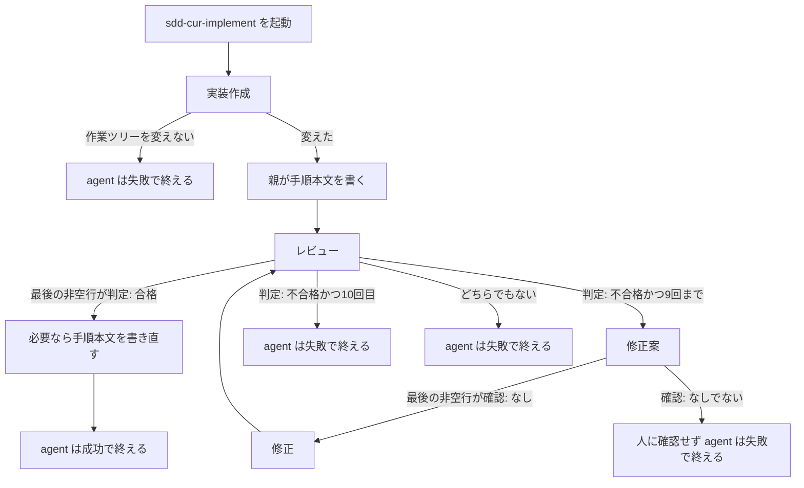

# 22 実装後にレビューと指摘をする

対象は [Issue #22](https://github.com/paterapatera/sdd-cur/issues/22)。実装のあとに、実装のレビューとレビュー指摘をする。手順は `sdd-cur-implement` スキルが行い、四つのサブエージェントは `install` がコピーする。課題ランナーは、レビューのために別の agent を起動しない。

## 受け入れ条件

- 課題ランナーが `sdd-cur-implement` を起動したあと、実装作成、レビューの順でサブエージェントが動く。不合格のときだけ修正案と修正をし、レビューに戻る。合格のときはレビューを終え、受け入れ手順の本文を書き直す必要があれば書き直す。
- レビューが不合格の回数が 10 回に達したら、修正案も修正も再レビューもせず、その実装を打ち切る。10 回目のレビューが不合格のときも打ち切る。打ち切りは、その一回の agent 起動を失敗で終える。
- レビューの指摘は、レビュー役のレスポンスだけである。ファイルにも課題コメントにも残さない。人への確認はしない。修正案作成も人に確認しない。
- 合格のレスポンスは、合格判定だけでよい。不合格のレスポンスは、不合格判定と、作業ツリー上のどこ（パス等）の何が、要求または設計のどの点に反するかを含む。
- `install` が、パッケージ内 `agents/<名前>.md` の実装用四つを、既存の要求用四つと設計用四つと同じ宛先へコピーする。引数を省くと `~/.cursor/agents/<名前>.md`、プロジェクトのルートを渡すと `<root>/.cursor/agents/<名前>.md` である。
- `bun test` は `gh` を起動しない。ホームディレクトリと、実行中の Cursor のスキルおよびサブエージェントは触らない。

## 範囲外

次は作らない。

- 要求を作ったあとの要求のレビューとレビュー指摘（#20）。`skills/sdd-cur/SKILL.md` の「要件」と、要求用の四つのサブエージェントは変えない
- 設計を作ったあとの設計のレビューとレビュー指摘（#21）。`skills/sdd-cur/SKILL.md` の「設計」と、設計用の四つのサブエージェントは変えない
- 要求を作るとき、課題に書いていない部分を人へ質問し、選択肢に評価スコアを添えること（#26）
- マージ時のブランチ削除（#18）
- 使いたくないプロジェクトでスキルを止めること（#19）
- 変えた仕様の巻き戻り防止（#23）
- ランナーのアサイン対象（#24）
- `sdd-cur.completion` の廃止（#25）
- 課題ランナーの「実装依頼」から「実装完了」までの順序（#6）。`src/runner.ts` と `src/agent.ts` は変えない。レビュー用の agent 起動は足さない
- Project A の SDD スキル（`sdd-cur`）で実装をレビューすること
- コミット、push、マージリクエスト、スカッシュマージ
- 課題の作成とクローズ。ラベルの変更
- 受け入れ手順のコメント投稿（#6）。レビュー合格後に、手順の本文を書き直す必要があれば書き直すことは、この設計に含める
- 完了処理
- 人への確認を、お客さまへの確認コメント（`sdd-cur: 確認`）と同じものにすること。この設計では人に確認しない。既存の確認手順は変えない
- レビューのレスポンスの、判定行と、不合格の指摘本文以外の見出しと件数の型
- 不合格の回数を、ファイル、課題コメント、または agent の再試行のあいだに残すこと
- Forgejo、Jira、Backlog
- `src/cli.ts`、`src/run.ts`、`src/sdd.ts`、`src/github.ts`、`src/complete.ts`、`src/conventions.ts` の変更
- `docs/plan.md`、`docs/conventions.md`、課題 1〜7 と課題 20 と課題 21 の `design.md` の書き換え
- 依存パッケージ。`package.json` の変更

## 決定

| 項目 | 内容 |
|---|---|
| サブエージェント | パッケージ内 `agents/` に、実装用の四つのファイルを足す。`install` が、要求用の四つ、設計用の四つとあわせてコピーする。スキルディレクトリの下には置かない |
| 起動 | `sdd-cur-implement` を実行している親が、サブエージェント名で起動する。`model` は渡さない。frontmatter の `model` を使う。課題ランナーは、レビューのために別の agent を起動しない |
| 実装を書く役 | 実装作成役と修正役だけである。親と、レビュー役と、修正案役は、作業ツリーの実装を変えない |
| 手順ファイルを書く役 | 親だけである。渡された絶対パスへ本文を書く。サブエージェントには手順パスを渡さない。サブエージェントは手順ファイルを変えない |
| 指摘の置き場所 | レビュー役のレスポンスだけである。ファイルにも課題コメントにも書かない |
| 判定 | レビュー役のレスポンスの最後の非空行は `判定: 合格` か `判定: 不合格` である。親はこの一行だけで分岐する。合格のとき、この行以外の評価文は必須ではない。要件の「合格判定だけでよい」は、この意味である。評価文を書いてもよい |
| 不合格の本文 | 最後の非空行は `判定: 不合格` である。それより前に、作業ツリー上のどこ（パス等）の何が、要求または設計のどの点に反するかを書く。指摘を判定行の後ろに置くと、最後の非空行が判定でなくなる。分岐は #20 および #21 と同型に、最後の非空行だけで行う |
| 合格 | 修正案役も修正役も起動しない。レビューは完了である。要求ファイルと設計ファイルは作らない。変えない。課題は閉じない。手順本文を書き直す必要があれば、親が同じパスへ書き直す。agent は成功で終える |
| 不合格 | 回数が 9 回までのときは、修正案、修正、レビューの順に戻る。人に確認しない。10 回目は打ち切る |
| 不合格の回数 | `sdd-cur-implement` の一回の agent 起動の中だけで数える。起動のたびに 0 から始める。ファイルにも課題コメントにも書かない。ランナーが `implement` を再試行しても、回数は引き継がない |
| 打ち切り | 10 回目のレビューが不合格のとき、修正案も修正も再レビューも起動しない。レビューに戻らない。agent は失敗で終える。終了コードは 0 以外である。理由の一行は `実装レビューが不合格のまま10回に達した` である。ランナーはこの失敗を、設計 6 の `implement` の拒否として扱う。`src/runner.ts` は変えない。二度とも拒否したときは、設計 6 のとおり、コミット、マージリクエスト、受け入れ手順のコメント、実装完了へ進まない |
| 手順の本文 | 実装作成が作業ツリーを変えたあと、レビューの前に、親が最初の本文を書く。印の行は書かない。レビュー合格後、修正で実装と合わなくなったときは、親が同じパスの本文を書き直す。合っているときは書き直さない。成功で終える前の本文は、空でなく、最初の非空行は印ではない。コメント投稿はしない |
| コピー元 | `agents/<名前>.md`。`<名前>` は下の表のファイル列である。要求用の四つと設計用の四つは、設計 21 の順のままリストの前に残す |
| コピー先 | 設計 20 のままである。引数を省くと `~/.cursor/agents/<名前>.md`。プロジェクトのルートを渡すと `<root>/.cursor/agents/<名前>.md` |
| スキルのコピー | 設計 1 のままである。パッケージ内 `skills/` 直下を、引数なしなら `~/.cursor/skills`、プロジェクト指定なら `<root>/.cursor/skills` へコピーする |
| 標準出力 | 設計 1 のままである。スキルの宛先を先に書く。サブエージェントの宛先は書かない |
| 失敗 | 理由は日本語の一行である。十二のコピー元のいずれかが揃わないときは、スキルもサブエージェントもコピーしない。agent を失敗で終えるときの理由も日本語の一行であり、標準エラーの最初の非空行、それが空のときは標準出力の最初の非空行に書く。これは設計 6 の失敗理由の順と同じである |

| 役割 | ファイル | サブエージェント名 | frontmatter の model | 作業ツリーを変える |
|---|---|---|---|---|
| 実装作成 | `sdd-cur-implement-author.md` | `sdd-cur-implement-author` | `grok-4.7[reasoning_effort=high,fast=false]` | 実装だけ |
| レビュー | `sdd-cur-implement-reviewer.md` | `sdd-cur-implement-reviewer` | `grok-4.7[reasoning_effort=medium,fast=false]` | 変えない |
| レビュー指摘の修正案作成 | `sdd-cur-implement-fix-proposer.md` | `sdd-cur-implement-fix-proposer` | `grok-4.7[reasoning_effort=high,fast=false]` | 変えない |
| 修正 | `sdd-cur-implement-fixer.md` | `sdd-cur-implement-fixer` | `composer-2.5[fast=false]` | 実装だけ |

人の言葉でのモデル名は、実装作成と修正案作成が grok-4.7-high、レビューが grok-4.7-medium、修正が composer-2.5 である。fast はすべて false であり、上の frontmatter の `model` と同じ一つの指定である。要求のレビュー（#20）と設計のレビュー（#21）の対応する役割と同じである。

| 不合格の回数 | すること |
|---|---|
| 1 から 9 | 修正案、修正のあと、レビューに戻る |
| 10 | 修正案も修正も再レビューもせず、agent を失敗で終える |

回数は、レビューの最後の非空行が `判定: 不合格` のときに 1 増やす。合格は回数に含めない。初回のレビューが不合格なら回数は 1 である。9 回目まで不合格のあとに修正し、次のレビューが不合格なら、その回が 10 のときに打ち切る。10 回目が合格のときは、レビューを終える。

## サブエージェント

各ファイルの最初のフロントマターは、`name`、`description`、`model` をこの順で持つ。レビュー役と修正案役は、その次に `readonly: true` を持つ。`name` はサブエージェント名と一文字も違わない。`model` は上の表と一文字も違わない。

本文は日本語である。どの役も、課題を作らない。課題を閉じない。ラベルを変えない。コミットしない。push しない。マージリクエストを作らない。スカッシュマージしない。コメントを投稿しない。`gh` を直接起動しない。受け入れ手順を投稿しない。完了処理をしない。確認コメントを投稿しない。人に確認しない。要求ファイルを作らない。要求ファイルは変えない。設計ファイルを作らない。設計ファイルは変えない。手順ファイルは変えない。

### 実装作成

課題ランナーが `sdd-cur-implement` を起動したとき、最初に一度だけ起動する。

- 渡された課題番号の `docs/specs/<番号>/requirements.md` と `docs/specs/<番号>/design.md` を読む。
- その設計の受け入れ条件、決定、範囲の中だけを、作業ツリーへ実装する。要求にも設計にも無い仕組みは足さない。
- 要求ファイルと設計ファイルは作らない。変えない。手順ファイルは変えない。
- 作業ツリーを変えないときは、実装を書かずに止まる。

### レビュー

実装作成が作業ツリーを変えたあと、および修正が作業ツリーを変えたあとに起動する。実装作成が作業ツリーを変えないで止まったときは、起動しない。

レビュー役はファイルを変えない。指摘はレスポンスだけである。レビューの対象は、作業ツリーの実装である。要求ファイルと設計ファイルそのものはレビューしない。見るのは、その実装が要求どおりに作られているかと、設計通りに作られているかである。

指摘にするのは、次だけである。

- 作業ツリーの実装が、要求どおりでない。
- 作業ツリーの実装が、設計通りでない。

好み、文体だけの提案、要求にも設計にも無い仕組みの追加案は、指摘にしない。

合格のとき、最後の非空行は `判定: 合格` である。この行以外の評価文は必須ではない。

不合格のとき、判定行より前に指摘を書く。指摘が一つでもあるときは不合格である。各指摘は、作業ツリー上のどこ（パス等）の何が、要求または設計のどの点に反するかを書く。最後の非空行は `判定: 不合格` である。この二行以外を最後の非空行にしない。

### 修正案

レビューの最後の非空行が `判定: 不合格` であり、増やしたあとの回数が 9 以下のときだけ起動する。10 回目は起動しない。

ファイルは変えない。人に確認しない。`確認: あり` は書かない。確認コメントは投稿しない。指摘に無い変更は書かない。要求にも設計にも無い仕組みは、決まったこととして書かない。要求ファイルと設計ファイルの変更は書かない。

適用できる変更があるときは、変更するパスごとに、修正役がそのまま書ける変更後の全文を書く。消すパスは、削除と書く。最後の非空行は `確認: なし` である。

適用できる変更が無いときは、`確認: なし` を書かない。

### 修正

修正案の最後の非空行が `確認: なし` のときだけ起動する。渡された修正案だけを、作業ツリーへ反映する。全文で書かれたパスは、その全文に置き換える。削除と書かれたパスは消す。それ以外のパスは変えない。要求ファイルと設計ファイルは、修正案に書いてあっても変えない。手順ファイルは変えない。

修正のあと、レビューに戻る。打ち切ったあとは、レビューに戻らない。

## スキルの手順

`skills/sdd-cur-implement/SKILL.md` のフロントマターは、設計 6 のまま残す。本文の `# sdd-cur-implement`、`## 実装`、`## 禁止` は残す。`## 実装` のあと、`## 禁止` の前に `## レビュー` を置く。`skills/sdd-cur/SKILL.md` は変えない。

親は、プロンプトのスキル名のあとにある課題番号と絶対パスを使う。親は作業ツリーへ実装を書かない。実装を書くのは、実装作成役と修正役だけである。

人がこのスキルを直接依頼したときも、課題ランナーが起動したときも、同じ手順である。`show` は呼ばない。業務ラベルでは止まらない。着手のラベル変更は、設計 6 のランナーが行う。

- サブエージェントは、表の名前で起動する。`model` は渡さない。
- 実装作成が作業ツリーを変えないで止まったときは、レビューを起動しない。理由は `実装作成が作業ツリーを変えませんでした` である。agent は失敗で終える。
- 実装作成が作業ツリーを変えたあとは、親が受け入れ手順の本文を、渡された絶対パスへ書く。印の行は書かない。この本文が、レビュー合格後に更新してよい最初の本文である。
- 不合格の回数は、この一回の agent 起動の中だけで数える。開始時は 0 である。ファイルにも課題コメントにも書かない。
- レビューの最後の非空行が `判定: 合格` のときは、修正案も修正も起動しない。最初の本文が実装と合わないときだけ、親が同じパスの本文を書き直す。印の行は書かない。要求ファイルと設計ファイルは作らない。変えない。課題は閉じない。成功で終える前の本文は、空でなく、最初の非空行は印ではない。
- 最後の非空行が `判定: 不合格` のときは、回数を 1 増やす。増やした回数が 10 のときは、修正案も修正も再レビューも起動しない。理由は `実装レビューが不合格のまま10回に達した` である。agent は失敗で終える。
- 増やした回数が 9 以下のときは、修正案を起動する。人に確認しない。確認コメントは投稿しない。
- 修正案の最後の非空行が `確認: なし` のときは、その修正案だけを修正へ渡す。修正のあと、レビューに戻る。
- 修正案の最後の非空行が `確認: なし` でないときは、人に見せて止まらない。人に確認しない。修正を起動しない。理由は `修正案を適用できません` である。agent は失敗で終える。
- レビューの最後の非空行が、合格と不合格のどちらでもないときは、修正案も修正も起動しない。理由は `レビューの判定がありません` である。agent は失敗で終える。
- 失敗で終えるとき、終了コードは 0 以外である。理由は日本語の一行であり、標準エラーの最初の非空行、それが空のときは標準出力の最初の非空行に書く。成功の完了では終えない。
- 成功で終えたとき、ランナーは設計 6 のとおり手順ファイルを読み、受け入れ手順のコメントと実装完了へ進む。この設計では、その順序を変えない。失敗のときは、設計 6 のとおり手順ファイルを読まず、二度目の `implement` も失敗したときにコミット、マージリクエスト、実装完了へ進まない。二度目の起動は別の一回であり、不合格の回数は 0 から始める。

## install

`src/install.ts` の `subagentFileNames` の末尾に、実装用の四つをこの順で足す。要求用の四つと設計用の四つは、今の順のまま前に残す。宛先の解決、スキルのコピー、標準出力、`src/cli.ts` の `cmdInstall` は変えない。

1. `sdd-cur-implement-author.md`
2. `sdd-cur-implement-reviewer.md`
3. `sdd-cur-implement-fix-proposer.md`
4. `sdd-cur-implement-fixer.md`

存在確認は、今の `assertSubagentSourceFiles` がリストの全ファイルを見る。実装用のいずれかが無いときも、要求用または設計用のいずれかが無いときと同じである。無いときは `サブエージェントがありません: agents/<名前>.md` である。ディレクトリのときは `サブエージェントではありません: agents/<名前>.md` である。この失敗のときは、スキルもサブエージェントもコピーしない。

コピーは、今の `installAgents` がリストの順で行う。同名があるときは、パッケージ側の内容に置き換える。宛先にある、この十二以外のファイルは残す。

## テスト

`bun test` で実行する。一時ディレクトリを使い、終わったら消す。

`install` は関数を直接呼ぶ。`subagentFileNames` が増えたあとでも、次は成功する。

- 引数なしのサブエージェントの宛先が、渡したホームに `.cursor/agents` を足したパスである。
- プロジェクトのルートを渡すと、`<root>/.cursor/agents` になる。
- 一時ディレクトリ上の `agents/` から、十二のファイルがコピーされる。中身はコピー元と一致する。要求用の四つと設計用の四つもコピーされる。
- 宛先に既にある、十二以外のファイルは残る。
- 同名のファイルは、パッケージ側の内容に置き換わる。
- 十二のいずれかが無いときは失敗し、スキルの宛先もサブエージェントの宛先も作られない。実装用の一つが無いときも、同じ失敗である。`src/install.test.ts` の、八つのいずれかが無い、というテストは、十二に合わせて確かめる。

起動の確認は、一時ディレクトリを使った子プロセスで行う。

- `bun src/cli.ts install <temp>` の終了コードは 0 である。
- `<temp>/.cursor/skills/sdd-cur-implement/SKILL.md` は、パッケージのそのファイルと一致する。
- `<temp>/.cursor/agents/` の十二のファイルは、パッケージの `agents/` の同じ名前と一致する。

`src/agents.test.ts` は、実装用四つのフロントマターの `name` と `model` が決定の表と一致することを確かめる。要求用四つと設計用四つの既存の確認は残す。実装のレビュー役の本文に `判定: 合格` と `判定: 不合格` がある。実装の修正案役の本文に `確認: なし` と `人に確認しない` がある。

`src/runner.test.ts` の `skills/sdd-cur-implement/SKILL.md` の確認は、設計 6 のフロントマターと、既存の必須文言を残す。加えて、`## レビュー`、四つの実装用サブエージェント名、`model は渡さない`、`判定: 合格`、`判定: 不合格`、`確認: なし`、`指摘はどこにも置かない`、`人に確認しない`、`実装レビューが不合格のまま10回に達した`、`別の agent を起動しない` が含まれる。

`src/sdd.test.ts` の、`skills/sdd-cur/SKILL.md` の必須文言の確認は残す。同ファイルの install は、`subagentFileNames` の全ファイルをパッケージと見比べる。リストが増えたあとでも成功する。

## 実装の順序

1. `agents/` に実装用の四つを書き、フロントマターと判定の文言をテストで確かめる。要求用の四つと設計用の四つは変えない。
2. `src/install.ts` の `subagentFileNames` の末尾に、実装用の四つを足す。十二のコピーと、実装用の一つが無いときの失敗を、関数テストで確かめる。
3. `skills/sdd-cur-implement/SKILL.md` に、上の手順を書く。設計 6 のフロントマターと禁止の文言は残す。`skills/sdd-cur/SKILL.md` は変えない。
4. 一時ディレクトリへの `install` で、`sdd-cur-implement` と十二のサブエージェントがコピーされることを確かめる。
5. README の `install` の説明を、`agents/<名前>.md` の十二をコピーする、に変える。`agents/` の説明に、実装レビュー用のサブエージェントを足す。
