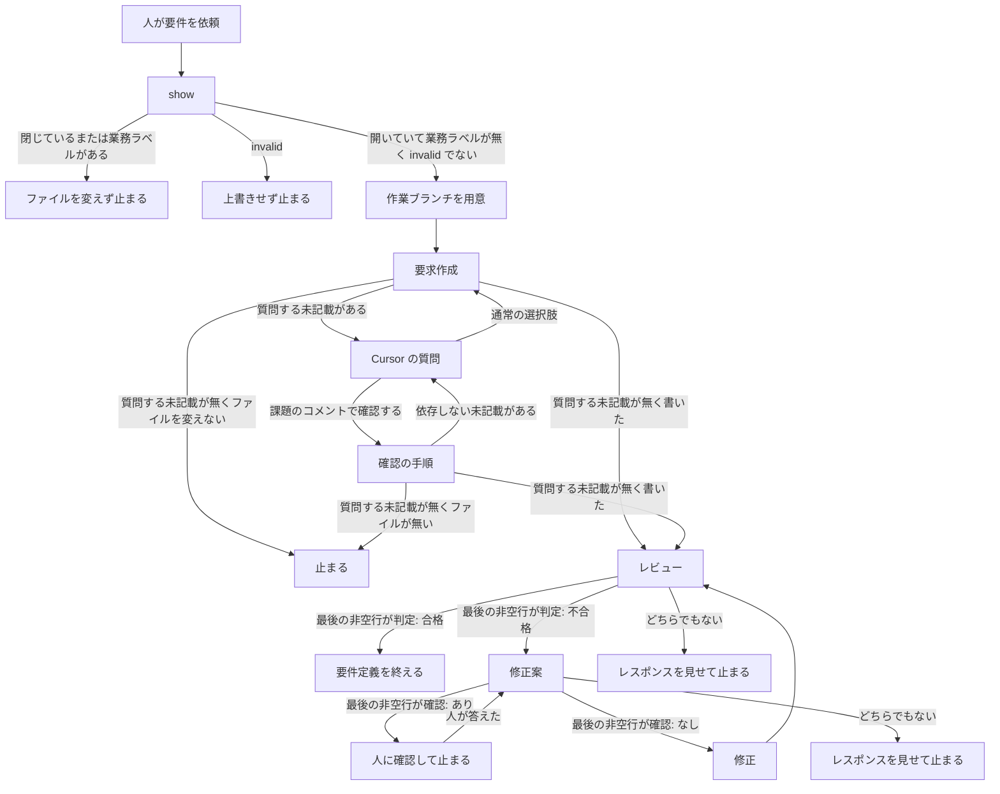
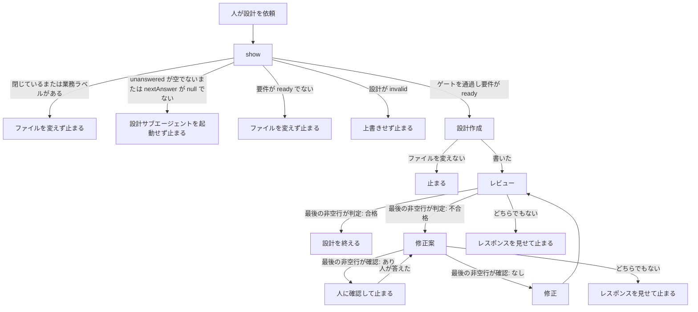

# 26 要求の未記載は人へ質問し評価スコアを添える

対象は [Issue #26](https://github.com/paterapatera/sdd-cur/issues/26)。要求を作るとき、課題に書いていない部分は決めずに人へ質問する。質問の選択肢には評価スコアを添える。手順は SDD スキルが行い、要求用の四つのサブエージェントの本文をこの手順に合わせる。

分割元は #16 である。評価の基準は、この課題の要件のとおりである。

## 受け入れ条件

- 要求を作るとき、課題に書いていない部分は決めない。人へ質問する。質問は、Cursor の質問機能で出す。
- 通常の選択肢のラベルは、先頭を `[スコア `、1 以上 5 以下の整数、`]` の順で始め、続けて選択肢本文とする。観点は質問本文に任意で示し、選択肢ラベルには入れない。
- 選択肢の最後は「課題のコメントで確認する」である。この選択肢は固定文言であり、上の形式もスコアも付けない。
- スコアは拘束力を持たない。最終決定は人が行う。
- 作業中の質問で、人が通常の選択肢を選んだ回答は、`reflect` では取り込まない。その答えは、人が決めた条件として要求の作成と要求の修正に渡し、仕様の文体で要求の「決定」節に書く。
- 質問のスコアは要求に書かない。採用されなかった選択肢は、通常は要求に書かない。E1、E2、E3 に当たるときだけ、「決定」節へ 1 行まで書き、詳細、スコア、比較表は書かない。
- 受け入れ条件に直結する決定は、受け入れ条件にも要約する。
- お客さま向け確認への回答は、従来どおり `reflect` で取り込む。
- 「課題のコメントで確認する」が選ばれた点は、要求の決定として書かない。課題コメントでの確認待ちとなる。その確認が `reflect` で終わるまで、設計には進まない。
- 確認待ちのあいだも、その点に依存しない未記載は、Cursor の質問と「決定」への反映を続けてよい。待ちの点の決定が他の節の文言を変えるとき、または AI がその未記載は待ちの点に依存すると判断したときは、その未記載は決めず、質問もしない。判断に迷ったときは保留し、決めず、質問もしない。
- 未回答の確認があるあいだ、およびまだ要求へ反映していない回答があるあいだ、次の確認は投稿しない。

## 範囲外

次は作らない。

- 要求を作ったあとのレビューの分岐そのもの（#20）。合格、不合格、`確認: あり`、`確認: なし`、指摘の置き場所は変えない
- 設計を作ったあとの設計のレビューとレビュー指摘（#21）。設計用の四つのサブエージェントは変えない。設計の手順へ足すのは、この設計のゲートだけである
- 実装のあとの実装のレビューとレビュー指摘（#22）。実装用の四つのサブエージェントは変えない
- 設計を作るとき、および実装のときの質問
- 新規のサブエージェント
- 作業ブランチを用意するタイミングと、デフォルトブランチから作業ブランチを作り直さないこと（#27）
- マージ時のブランチ削除（#18）
- 使いたくないプロジェクトでスキルを止めること（#19）
- 変えた仕様の巻き戻り防止（#23）
- ランナーのアサイン対象（#24）
- `sdd-cur.completion` の廃止（#25）
- 課題の作成とクローズ。ラベルの変更。実装。受け入れ手順。完了処理
- `confirm` と `reflect` の印。`src/conventions.ts` の変更
- `src/cli.ts`、`src/sdd.ts`、`src/install.ts`、`src/run.ts`、`src/runner.ts`、`src/agent.ts`、`src/github.ts`、`src/complete.ts` の変更。`show` は `unanswered` と `nextAnswer` を既に返す
- `docs/plan.md`、`docs/conventions.md`、README、AGENTS.md、この課題以外の `design.md` の書き換え
- Forgejo、Jira、Backlog
- 依存パッケージ。`package.json` の変更

## 決定

| 項目 | 内容 |
|---|---|
| 質問を出す主体 | SDD スキルの親。要求作成役、レビュー役、修正案役、修正役は質問を出さない |
| 質問の手段 | Cursor の質問機能。質問する未記載ごとに質問を一つ出す |
| 質問の対象 | 要求作成役が親への返信で質問すると分けた未記載のうち、親が保留しない点 |
| 通常の選択肢 | 1 つ以上。ラベルは `[スコア `、1 以上 5 以下の十進の整数、`]`、選択肢本文の順。先頭の零は付けない |
| 観点 | 内側では常に考える。質問本文に書くのは任意。選択肢ラベルには入れない |
| 最後の選択肢 | 固定文言 `課題のコメントで確認する`。形式もスコアも付けない。質問ごとに、通常の選択肢のうしろに一つ置く |
| スコア | 親が見積もる総合スコア。拘束力は無い。人が選ぶまで要求に書かない。人が決めた条件にも要求にも書かない |
| 通常の回答 | `reflect` では取り込まない。`confirm` の標準入力にもしない。レビューに入る前は、人が決めた条件として要求作成役を再び起動する |
| 修正へ渡す条件 | レビューに入る前に人が選んだ通常の回答を、修正役を起動するときに人が決めた条件として渡す |
| 決定の場所 | 「決定」節。節が無いときは受け入れ条件の直後に置く。既にあるときは、その節へ続ける |
| 不採用 | 通常は書かない。E1、E2、E3 のときだけ「決定」節へ 1 行。詳細、スコア、比較表は書かない |
| 受け入れ条件 | 直結する決定は、受け入れ条件にも要約する |
| 最後の選択 | 決定として書かない。待ちの点になる。確認の手順で payload を承認したあとだけ `confirm` を実行する |
| 次の確認 | `unanswered` が空でない、または `nextAnswer` が `null` でないときは投稿しない。確認の節の手順は変えない |
| 確認待ちの続き | 依存せず保留でもない未記載は、質問と「決定」節への記載を続けてよい |
| 依存と保留 | 決めない。質問しない。要求に書かない |
| 「決定」への反映 | 要求作成役または修正役が「決定」節へ書くことである。作業中の通常の回答では `reflect` を呼ばない |
| お客さまの回答 | 従来の回答の手順で `reflect` する |
| 設計ゲート | `show` の `unanswered` が空でない、または `nextAnswer` が `null` でないときは、設計のサブエージェントを起動しない |
| レビューの分岐 | 設計 20 のままである。指摘はレスポンスだけであり、ファイルにも課題コメントにも残さない |
| サブエージェント | 要求用の四つは設計 20 の名前と `model` のままである。`model` は渡さない。設計用四つと実装用四つは変えない |
| install | 手順は増やさない。`subagentFileNames` の順は変えない |
| 作業ブランチ | 設計 27 のままである。質問は、作業ブランチを用意したあとで出す |

人が決めた条件として渡すのは、選ばれた通常の選択肢の本文である。スコアは渡さない。

- E1: その本文が採用しない旨を明示しているときだけ、採用しない旨を渡す。要求の「決定」節へ、採用しないと 1 行書く。
- E2: 人が同意したうえで、不採用案を書くことで誤実装や範囲の混同を防ぐときだけ、その不採用案を渡す。要求の「決定」節へ、その不採用案を 1 行書く。同意が無いとき、または誤実装や範囲の混同を防ぐことに当たらないときは書かない。
- E3: 通常の選択肢が二つで、人が一方を選んだときは、選ばれなかった方を採用しない旨を渡す。要求の「決定」節へ、他方を採用しないと短く 1 行書く。通常の選択肢が二つ以外のときは、E3 として書かない。

総合スコアの観点は次である。高いスコアほど、課題と計画の範囲内で要求として妥当であり、後工程の手戻りが少ないと親が見積もる選択肢である。

- 課題整合
- 計画整合
- 仕様の明確さ
- 範囲の狭さ
- あとでお客さま確認が要る度合い

| スコア | 目安 |
|---|---|
| 5 | 自然で明確 |
| 4 | 妥当 |
| 3 | どちらともいえない |
| 2 | 弱い |
| 1 | 課題の外である、計画に反する、または兄弟課題が混ざるリスクが高い |

`課題のコメントで確認する` には、このスコアを付けない。

## サブエージェント

要求用の四つの frontmatter の `name` と `model` は、設計 20 の表と一文字も違わない。レビュー役と修正案役の `readonly: true` は残す。本文は日本語である。どの役も、課題を作らない。課題を閉じない。ラベルを変えない。実装しない。コミットしない。`gh` を直接起動しない。受け入れ手順を投稿しない。完了処理をしない。確認コメントを投稿しない。設計ファイルを作らない。質問を出さない。

### 要求作成

起動の条件、見出し、`missing`、`invalid`、`ready` の扱いは、設計 20 のままである。既存の正しい見出しは変えない。

課題に書いていない部分は決めない。要求の中の決めとして書かない。親への返信の決められない点を、次の二つに分ける。

- 質問する未記載
- 依存または保留のため質問しない未記載

依存と保留の判定は、要件の「質問」の節のとおりである。待ちの点の決定が他の節の文言を変えるとき、またはその未記載は待ちの点に依存すると判断したときは、質問しない側へ入れる。判断に迷ったときも、質問しない側へ入れる。待ちの点とは、「課題のコメントで確認する」が選ばれた点である。

人が通常の選択肢を選んだ答えが、人が決めた条件として渡されたときは、仕様の文体で「決定」節に書く。「決定」節が無いときは、受け入れ条件の直後に置く。既にあるときは、その節へ続ける。再び起動されたときも、既存の正しい見出しは変えず、本文を続ける。

質問のスコアは書かない。採用されなかった選択肢は、通常は書かない。E1、E2、E3 は、渡された人が決めた条件にその旨があるときだけ、「決定」節へ 1 行書く。詳細、スコア、比較表は書かない。受け入れ条件に直結する決定は、受け入れ条件にも要約する。

「課題のコメントで確認する」が選ばれた点は、「決定」節へ書かない。依存がある未記載と、保留した未記載は、書かない。確認待ちに依存しない未記載は、「決定」節へ書いてよい。

### レビュー

起動のタイミング、指摘の置き場所、最後の非空行は、設計 20 のままである。`判定: 合格` と `判定: 不合格` 以外を最後の非空行にしない。

指摘にするものへ、次を足す。

- 質問のスコアが要求に書いてある。
- 採用されなかった選択肢が、E1、E2、E3 の各 1 行以外で書いてある。詳細、スコア、比較表が書いてある。
- 「課題のコメントで確認する」を選んだ点が、決定として書いてある。
- 人が通常の選択肢で決めた条件が、「決定」節に無い。
- 受け入れ条件に直結する決定が、受け入れ条件に要約されていない。
- 課題に書いていない部分が、人が決めた条件も無しに決定として書いてある。

設計 20 の、見出し、人が決めた条件に無い挙動、人が決めた条件の欠落、兄弟課題、設計ファイルをこの要求の手順で作ること、は残す。好みと文体だけの提案は、指摘にしない。

### 修正案

起動の条件、`確認: あり`、`確認: なし` は、設計 20 のままである。指摘に無い変更は書かない。課題、計画、人が決めた条件に無い仕組みは、決まったこととして書かない。質問のスコアは書かない。採用されなかった選択肢の詳細、スコア、比較表は書かない。E1、E2、E3 は、人が決めた条件にあるときだけ 1 行を残す。人が決めた条件の「決定」を、全文から落とさない。課題に書いていない部分を、人が決めた条件も無しに足さない。

### 修正

修正案の最後の非空行が `確認: なし` のときだけ起動する。渡された修正案を、その課題の要求ファイルへ反映する。正しい見出しは、修正案が見出しの変更を明示したときだけ変える。設計ファイルは変えない。

人が決めた条件として渡された通常の回答は、要求作成と同じ規則で「決定」節へ書く。修正案にその決定が無くても書く。質問のスコアは書かない。「課題のコメントで確認する」が選ばれた点、依存がある未記載、保留した未記載は書かない。それ以外は、修正案に無い文を足さず、修正案に無い文を消さない。

## スキルの手順

`skills/sdd-cur/SKILL.md` の「要件」と「設計」を変える。着手、確認、回答、禁止は変えない。作業ブランチの用意は設計 27 のままである。レビューの分岐は設計 20 と設計 21 のままである。既存の必須文言は残す。フロントマターは変えない。`src/sdd.ts` とは書かない。

### 要件

人が要件を依頼したときは、先に `bun src/cli.ts show <番号>` を実行する。`state` が `open` でないとき、および業務ラベルが一つでもあるときは、これまでどおり止まり、ファイルを変えず、サブエージェントも起動しない。作業ブランチも用意しない。要件の状態が `invalid` のときは上書きしない。作業ブランチも用意しない。サブエージェントは起動しない。

課題が開いていて業務ラベルが無く、要件の状態が `invalid` でないときは、要求作成役を起動する前に作業ブランチを用意する。名前は `implementationBranch` の戻り値である。用意は、この手順の中で行う。実装のランナーは、この用意をしない。用意したとき、Project A の作業ツリーはその作業ブランチである。要求ファイルは、この作業ツリーに書く。デフォルトブランチには書かない。

要求作成役の返信に、質問する未記載があるときは、レビューに入る前に、その点を質問する。親が判断に迷う点は保留し、質問しない。要求作成役が質問しないと分けた点も、質問しない。

質問のラベルは、決定の表のとおりである。観点を示すときは質問本文に書き、五つの観点名を使う。示さなくてもよい。通常の選択肢を 1 つ以上並べ、最後に `課題のコメントで確認する` を置く。スコアが高い選択肢を、親は選ばない。人が選ぶまで、その点は要求に書かない。

- サブエージェントは、設計 20 の四つの名前で起動する。`model` は渡さない。
- 人が通常の選択肢を選んだあとは、その答えを人が決めた条件として要求作成役を再び起動する。`reflect` は呼ばない。
- 人が `課題のコメントで確認する` を選んだあとは、その点を決定として書かない。確認の手順に入る前に `show` を改めて実行する。確認の節に従い、payload を人に見せ、人がその本文を承認したあとだけ `bun src/cli.ts confirm <番号>` を実行する。印の行は入れない。人が直したときは、確認の節のとおり、直した文字列を改めて見せ、その文字列の承認があるまで `confirm` を実行しない。
- `unanswered` が空でないとき、および `nextAnswer` が `null` でないときは、確認の節のとおり次の確認は投稿しない。その点は決定として書かず、依存の判断では待ちの点として扱う。
- 確認待ちのあいだ、依存しない未記載は質問を続ける。通常の回答は要求作成役が「決定」節へ書く。
- 質問する未記載が無く、ファイルを書いていないときは止まる。ファイルを書いていれば、設計 20 のレビューに入る。
- レビューの `確認: あり` では、これまでどおり確認コメントを投稿しない。人が答えるまで、その部分は要求へ書かない。人が答えたあとは、その答えを人が決めた条件として修正案役を再び起動する。この止まりは、採点付きの質問とは別である。
- `確認: なし` のときは、その修正案だけを修正役へ渡す。あわせて、レビューに入る前に人が選んだ通常の回答を、人が決めた条件として渡す。修正のあと、レビュー役に戻る。合格になるまで繰り返す。
- 最後の非空行が、その役の二択のどちらでもないときは、修正案役も修正役も起動しない。レスポンスを人に見せて止まる。
- レビューの最後の非空行が `判定: 合格` のときは、修正案役も修正役も起動しない。人に伝える前に `show` を改めて実行する。`unanswered` が空であり、かつ `nextAnswer` が `null` であるときは、判定が合格なら設計に進むことができる、と伝える。どちらかが残っているときは、確認が `reflect` で終わるまで設計には進まない、と伝える。設計のファイルはこの手順で作らない。課題は閉じない。設計の手順は、人が設計を依頼したときだけ始める。

### 設計

人が設計を依頼したときは、先に `bun src/cli.ts show <番号>` を実行する。`state` が `open` でないとき、および業務ラベルが一つでもあるときは、これまでどおり止まり、ファイルを変えず、サブエージェントも起動しない。

その次にゲートを見る。`unanswered` が空でないときは、未回答の確認があるため、設計には進まない、と伝えて止まる。`nextAnswer` が `null` でないときは、まだ要求へ反映していない回答があるため、設計には進まない、と伝えて止まる。両方が残っているときは、未回答の確認を先に伝える。ファイルを変えず、設計のサブエージェントを起動しない。

ゲートを通過したあとは、設計 21 と設計 27 のままである。要件の状態が `ready` でないときは、`missing` なら要件が無い、`invalid` なら要件の見出しが不正である、と伝えてファイルを変えない。サブエージェントは起動しない。`specs.design` が `invalid` のときは上書きしない。サブエージェントは起動しない。`missing` と `ready` の見出しの扱いは、設計作成役に渡す。設計作成役は、既存の正しい見出しは変えない。親は設計ファイルを自分では書かない。

要件の状態が `ready` であり、設計の状態が `invalid` でないとき、設計ファイルを書く作業ツリーは、要求のときに用意した同じ作業ブランチである。デフォルトブランチから作業ブランチを作り直さない。設計ファイルは、この作業ツリーに書く。デフォルトブランチには書かない。

- サブエージェントは、設計 21 の四つの名前で起動する。`model` は渡さない。
- 合格のときは、修正案も修正も起動しない。要求ファイルは作らない。課題は閉じない。判定が合格なら実装依頼に進むことができる、と人に伝える。人が設計の完了を伝えたときは、push と「実装依頼」は人が行う。push するのは、要求と設計を含む作業ブランチである。
- 不合格の分岐、`確認: あり`、`確認: なし`、最後の非空行が二択のどちらでもないときの止まりは、設計 21 のままである。

## install

`src/install.ts` は変えない。`subagentFileNames` の順は変えない。要求用四つはリストの前のまま、設計用四つはその次、実装用四つはその次である。コピー手順は足さない。宛先、標準出力、ソースが揃わないときの失敗は、設計 21 のままである。

インストールがコピーする要求用四つの中身は、この設計で変えた本文である。設計用四つと実装用四つのファイルは変えない。

## テスト

`bun test` で実行する。一時ディレクトリを使い、終わったら消す。`gh` は起動しない。ホームディレクトリと、実行中の Cursor のスキルおよびサブエージェントは触らない。

`src/agents.test.ts` の要求用四つは、`name` と `model` が設計 20 の表と一致したままであることを確かめる。設計用四つと実装用四つの既存の期待は残す。

- 要求作成役の本文に `決定`、`質問のスコアは書かない`、`課題のコメントで確認する` がある。
- 修正役の本文に `人が決めた条件`、`決定`、`質問のスコアは書かない` がある。
- 修正案役の本文に `確認: あり`、`確認: なし`、`質問のスコアは書かない` がある。
- レビュー役の本文に `判定: 合格`、`判定: 不合格`、`E1`、`E2`、`E3` がある。

`src/sdd.test.ts` の既存の必須文言は残す。加えて、`skills/sdd-cur/SKILL.md` に次が含まれる。

- `Cursor の質問機能`
- `[スコア `
- `課題のコメントで確認する`
- `スコアは拘束力を持たない`
- `reflect では取り込まない`
- `E1`
- `E2`
- `E3`
- `課題整合`
- `計画整合`
- `仕様の明確さ`
- `範囲の狭さ`
- `あとでお客さま確認が要る度合い`
- `自然で明確`
- `どちらともいえない`
- `兄弟課題が混ざる`
- `unanswered`
- `nextAnswer`
- `設計には進まない`
- `質問もしない`

`src/sdd.ts` はスキルの本文に含まれない。`install` の既存のテストは、これまでどおり成功する。

## 実装の順序

1. 要求用四つの本文を、この設計に合わせる。`src/agents.test.ts` に、上の文言の期待を足す。frontmatter は変えない。設計用四つと実装用四つは変えない。
2. `skills/sdd-cur/SKILL.md` の「要件」に質問を足し、「設計」にゲートを足す。`src/sdd.test.ts` の必須文言に、上の文言を足す。既存の必須文言は残す。
3. `bun test` が成功することを確かめる。