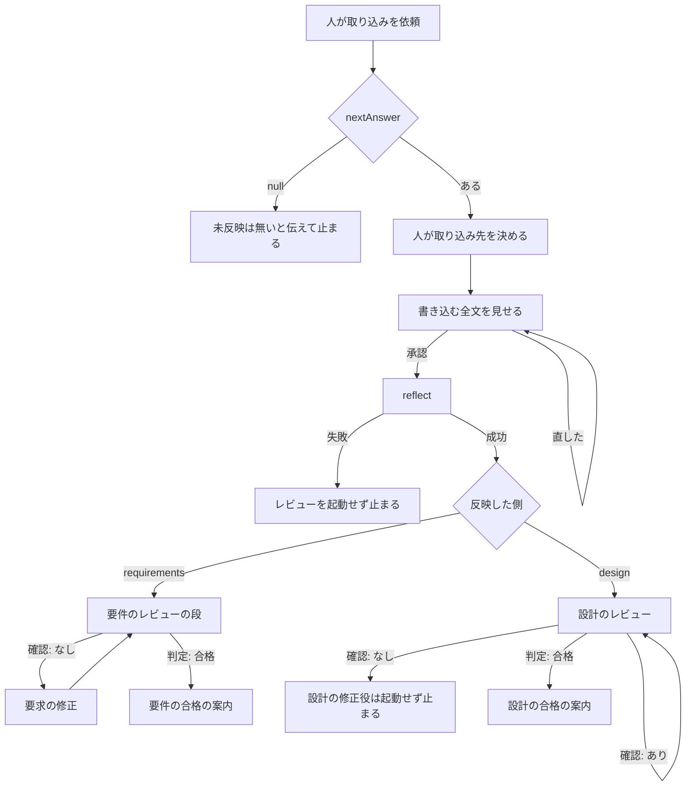

# 38 回答の反映は全文の承認後にしレビューへ戻す

対象は [Issue #38](https://github.com/paterapatera/sdd-cur/issues/38)。回答の反映は、書き込む全文の承認のあとだけ `reflect` する。成功したあとは、反映した側の既存のレビューを起動する。その判定が合格するまで、設計の作成と設計の修正へ進まず、設計へ進める案内も実装依頼へ進める案内もしない。

## 受け入れ条件

- 回答の手順は、`reflect` の標準入力に渡す書き込む全文を、人に見せる。
- 回答の手順は、人がその全文を承認したあとだけ、`reflect` を実行する。
- 人が書き込む全文を直したとき、回答の手順は、直した文字列を改めて人に見せる。
- 回答の手順は、その直した文字列の承認があるまで、`reflect` を実行しない。
- 回答の手順は、`reflect` が成功したあと、反映した側の既存のレビューを起動する。
- 回答の手順は、反映した側のレビューの判定が合格するまで、設計の作成手順を続けない。
- 回答の手順は、反映した側のレビューの判定が合格するまで、設計の修正手順を続けない。
- 回答の手順は、その合格の前に、設計に進める旨を伝えない。
- 回答の手順は、その合格の前に、実装依頼に進める旨を伝えない。
- 取り込み先が `requirements` のときと `design` のときで、合格までのゲートは同じである。
- 反映のあと、未回答が空であり、かつ未反映が無いことだけでは、回答の手順は合格までのゲートを満たしたことにしない。

## 範囲外

次は作らない。

- 回答コメントの投稿
- 一度の依頼で、次の未反映へ続けること
- 課題の作成とクローズ
- ラベルの変更
- 実装
- 受け入れ手順
- 完了処理
- Forgejo、Jira、Backlog
- `skills/sdd-cur/SKILL.md` の着手、要件、設計、確認、禁止の節の書き換え
- 要件の節と設計の節にある、合格のあとの案内の文言の変更
- 要求のレビュー、要求の修正、設計のレビューの、回答の手順以外での分岐
- サブエージェントの本文。新規のサブエージェント
- `src/sdd.ts` の `reflect` と `applyIncorporatedAnswer`
- `src/cli.ts`、`src/conventions.ts`、`src/install.ts`、`src/run.ts`、`src/runner.ts`、`src/agent.ts`、`src/github.ts`、`src/complete.ts` の変更
- `src/agents.test.ts` の期待の変更
- `docs/plan.md`、`docs/conventions.md`、README、AGENTS.md、この課題以外の `design.md` と `requirements.md` の書き換え
- 依存パッケージ。`package.json` の変更

## 決定

| 項目 | 内容 |
|---|---|
| 変えるスキル | `skills/sdd-cur/SKILL.md` の「回答」だけ。着手、要件、設計、確認、禁止は変えない |
| 変えるコード | 無し。`src/sdd.ts` の `reflect` は変えない |
| 承認の位置 | 確認と同じく、スキルの手順が人の承認を取る。`reflect` は承認を待たない。渡された全文を、今どおり検証して書く |
| 書き込む全文 | 人が取り込み先を選んだあと、`reflect` の標準入力へ渡す、決定を書いた全文 |
| 直したとき | 確認と同じ再承認。直した文字列を改めて見せ、その文字列の承認があるまで `reflect` を実行しない |
| 標準入力 | 人が承認した書き込む全文。直して承認したあとは、その承認した文字列。印の行は入れない。本文には id を書かない |
| レビュー | `reflect` が成功したあと、要件の「レビューへ戻す」で言う反映した側の既存のレビューを起動する。要求なら、要件の節のレビューの段全体である。設計なら、`確認: あり` の再レビュー、印が壊れているときのやり直し、確認行が無いときの止まりは、設計の節と同じである。`確認: なし` のときは、設計の修正役は起動しない |
| 合格 | そのレビューの判定行が `判定: 合格` であること。判定行の探し方は、反映した側の節にある既存の手順と同じ |
| 合格までのゲート | 取り込み先が `requirements` のときと `design` のときで同じ。設計の作成手順を続けない。設計の修正手順を続けない。設計に進める旨を伝えない。実装依頼に進める旨を伝えない |
| キューだけでは足りない | 反映のあと、未回答が空であり、かつ未反映が無いことだけでは、このゲートは満たされない |
| 要求の修正 | 要求へ反映したあと、レビューが `確認: なし` のときは、要件の節と同じく要求の修正役へ渡し、合格まで繰り返す。設計の修正手順ではない |
| 設計へ反映後 | 設計へ反映したあとの `確認: あり` の再レビュー、印が壊れているときのやり直し、確認行が無いときの止まりは、設計の節と同じである。`確認: なし` のときは、設計の修正役は起動しない |
| 設計の修正 | 回答の手順は、判定が合格するまで設計の修正役を起動しない。設計へ反映したときの `確認: なし` でも起動しない |
| 合格のあと | 反映後のレビューが `判定: 合格` のあと、反映した側の節の合格時と同じ案内を出す。設計の作成役と設計の修正役は起動しない |
| 次の未反映 | 一度の `reflect` のあと、残りの未反映があっても、次の依頼まで続けない |
| install | 手順と `subagentFileNames` は変えない |

`reflect` は、設計 5 のまま、標準入力の全文を受け取り、選んだ側へ id を足して書く。承認の有無は見ない。レビューは起動しない。確認の `confirm` が承認を待たず、渡された payload を投稿するのと同じ分け方である。承認、直したあとの再承認、成功後の既存のレビュー（要求の修正の繰り返し、設計側のレビュー分岐、合格後の案内を含む）は、スキルの「回答」が行う。

## スキルの手順

`skills/sdd-cur/SKILL.md` の「回答」を、次に合わせる。着手、要件、設計、確認、禁止の節は変えない。既存の、未反映が無いときの止まり、取り込み先を決めるまでの止まり、`reflect` が成功するまでディスク上のファイルを変えないこと、反映済みブロックより前への追記、本文に id を書かないこと、一度の `reflect` のあと次の未反映へ続けないこと、回答コメントを投稿しないこと、は残す。

書き込む全文は、人が `requirements` か `design` かを選んだあと、`bun src/cli.ts reflect <番号> <requirements|design>` の標準入力へ渡す、決定を書いた全文である。

- 回答の手順は、この全文を人に見せる。人がその全文を承認したあとだけ、`reflect` を実行する。
- 人が書き込む全文を直したときは、直した文字列を改めて見せる。その直した文字列の承認があるまで、`reflect` を実行しない。
- 標準入力は、人が承認した書き込む全文である。人が直してその文字列を承認したあとは、標準入力はその承認した文字列である。印の行は入れない。本文には id を書かない。
- `reflect` が失敗したときは、レビューを起動しない。設計の作成手順も設計の修正手順も続けない。設計に進める旨も、実装依頼に進める旨も伝えない。
- `reflect` が成功したあと、要件の「レビューへ戻す」で言う反映した側の既存のレビューを起動する。側が `requirements` のときは、要件の節のレビューの段全体である。側が `design` のときは、`確認: あり` の再レビュー、印が壊れているときのやり直し、確認行が無いときの止まりは、設計の節と同じである。`確認: なし` のときは、設計の修正役は起動しない。
- 合格は、そのレビューの判定行が `判定: 合格` であることである。判定行は、反映した側の節と同じく、レスポンス本文を下から見て決める。
- この合格まで、設計の作成手順を続けない。設計の修正手順を続けない。設計に進める旨を伝えない。実装依頼に進める旨を伝えない。このゲートは、取り込み先が `requirements` のときと `design` のときで同じである。
- 反映のあと、未回答が空であり、かつ未反映が無いことだけでは、このゲートを満たしたことにしない。`show` の `unanswered` と `nextAnswer` だけで、二つの案内を決めない。

合格までのあいだ、どちらの側でも、設計の作成役と設計の修正役は起動せず、二つの案内もしない。印が壊れているときのやり直しと、確認行が無いときの止まりは、図に無く、反映した側の節と同じである。

### 要求へ反映したとき

既存のレビューは、スキルの「要件」にあるレビューの段である。レビューと、そのあとの要求の修正は、その段と同じである。判定行、印が壊れているときのやり直し、`確認: あり`、`確認: なし`、確認行が無いときの止まり、回数、モデルを含む。`確認: なし` のときは、その差分だけを要求の修正役へ渡す。修正のあと、要求のレビューに戻る。合格になるまで、この段を繰り返す。

この繰り返しのあいだ、判定が `判定: 合格` になるまで、設計の作成役も設計の修正役も起動しない。設計に進める旨も、実装依頼に進める旨も伝えない。要求の修正役の起動は、設計の修正手順ではない。

判定が `判定: 合格` のあとの案内は、要件の節の合格のときと同じである。人に伝える前に `show` を改めて実行する。`unanswered` が空であり、かつ `nextAnswer` が `null` であるときは、判定が合格なら設計に進むことができる、と伝える。どちらかが残っているときは、確認が `reflect` で終わるまで設計には進まない、と伝える。設計のファイルはこの手順で作らない。設計の手順は、人が設計を依頼したときだけ始める。回答の手順は、この合格のあとでも、設計の作成役と設計の修正役を起動しない。

### 設計へ反映したとき

既存のレビューは、スキルの「設計」にあるレビューの段である。設計のレビュー役を起動する。判定行、印が壊れているときのやり直し、`確認: あり`、確認行が無いときの止まりは、その段と同じである。`確認: あり` で人が答えたあとにレビューを再び起動するのも、設計の節と同じである。この再起動は、設計の修正手順ではない。

判定が `判定: 合格` でないあいだは、設計の作成役も設計の修正役も起動しない。`確認: なし` でも、設計の修正役は起動しない。レビューのレスポンスを人に見せて止まる。設計に進める旨も、実装依頼に進める旨も伝えない。

判定が `判定: 合格` のあとの案内は、設計の節の合格のときと同じである。修正を起動しない。作成も起動しない。判定が合格なら実装依頼に進むことができる、と人に伝えて終わる。人が設計の完了を伝えたときは、push と「実装依頼」は人が行う。

## テスト

`bun test` で実行する。一時ディレクトリを使い、終わったら消す。`gh` は起動しない。ホームディレクトリと、実行中の Cursor のスキルおよびサブエージェントは触らない。

`src/sdd.test.ts` の `skills/sdd-cur/SKILL.md` の必須文言に、次を足す。既存の必須文言は残す。

- `書き込む全文を人に見せる`
- `その全文を承認したあとだけ`
- `reflect を実行しない`
- `反映した側の既存のレビュー`
- `要求のレビュー`
- `設計のレビュー`
- `設計の作成手順を続けない`
- `設計の修正手順を続けない`
- `設計に進める旨を伝えない`
- `実装依頼に進める旨を伝えない`
- `未反映が無いことだけでは`
- `確認: なしでも、設計の修正役は起動しない`

`src/sdd.ts` の `reflect` と `applyIncorporatedAnswer` の既存のテストは、期待を変えない。`src/agents.test.ts` の期待は変えない。

## 実装の順序

1. `skills/sdd-cur/SKILL.md` の「回答」を、この設計のスキルの手順に合わせる。他の節は変えない。
2. `src/sdd.test.ts` の必須文言に、上の文言を足す。既存の必須文言は残す。
3. `bun test` が成功することを確かめる。
