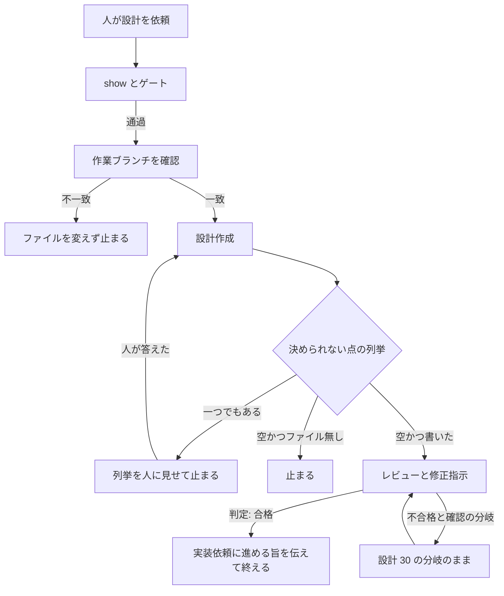

# 39 設計の未決が残るあいだは実装依頼へ進まない。。

対象は [Issue #39](https://github.com/paterapatera/sdd-cur/issues/39)。設計作成役が親への返信に残した決められない点があるあいだ、`sdd-cur` の設計の手順はレビューに入らず、合格として実装依頼へ進める旨を伝えない。列挙を人に見せて止まる。

## 受け入れ条件

- 設計作成役の返信に含まれる、ファイルへ書かなかった決められない点の列挙が、一つでもあるとき、親は設計レビューを起動しない。
- 上のとき、親は設計修正指示を起動しない。設計の修正役も起動しない。
- 上のとき、親は、判定が合格なら実装依頼に進めることができる、と人に伝えない。
- 上のとき、親は、列挙された決められない点を人に見せ、設計の手順を止まる。
- 上のとき、決められない点は設計ファイルへ書かない。
- 設計作成役の返信の決められない点の列挙が空のときだけ、設計ファイルを書いたあと、設計レビューと修正指示に入ってよい。
- 人が答えたあとは、その答えを人が決めた条件として、設計作成役を再び起動する。列挙が空になるまで、設計レビューに入らない。
- 設計の手順の、数えるレビューの回数、レビューのモデル、印が壊れているときのやり直し、判定行と確認行、`確認: なし` の修正、二択でないときの止まりは、本設計で変えない。

## 範囲外

次は作らない。

- 要求の手順と同じ、採点付きの質問と Cursor の質問機能を設計に足すこと
- `agents/sdd-cur-design-author.md` の変更。決められない点を返す形は現状のままである
- 設計レビュー役の指摘観点の変更。`agents/sdd-cur-design-reviewer.md` は変えない
- 設計の修正役の変更。`agents/sdd-cur-design-fixer.md` は変えない
- quick の設計の段（#56 で扱う）
- 課題の作成とクローズ。ラベルの変更
- 実装。受け入れ手順。完了処理
- `src/runner.ts`、`src/run.ts`、`src/agent.ts`、`src/cli.ts`、`src/sdd.ts`、`src/install.ts`、`src/github.ts`、`src/complete.ts`、`src/conventions.ts` の変更
- `skills/sdd-cur-implement/SKILL.md`、`skills/sdd-cur-complete/SKILL.md`、`skills/sdd-cur-quick/SKILL.md` の変更
- 着手、要件、確認、回答、禁止の変更
- `docs/plan.md`、`docs/conventions.md`、README、AGENTS.md、この課題以外の `design.md` と `requirements.md` の書き換え
- Forgejo、Jira、Backlog
- 依存パッケージ。`package.json` の変更

## 決定

| 項目 | 内容 |
|---|---|
| 変えるスキル | `skills/sdd-cur/SKILL.md` の「設計」だけ。frontmatter は変えない |
| 返信の読み方 | 設計作成役の返信から、「ファイルへ書かなかった、決められない点」の見出しと同じ語の列挙を読む。見出しの文言は `agents/sdd-cur-design-author.md` と一文字も違わない |
| 列挙が空でない | 列挙の内容をそのまま人に見せて止まる。`sdd-cur-design-reviewer` と `sdd-cur-design-fixer` は起動しない。判定が合格なら実装依頼に進めることができる、とは伝えない |
| 設計ファイル | 決められない点は設計ファイルへ書かない。親も書かない。設計作成役が書いたあとでも、列挙が空でないときはレビューに入らない |
| 列挙が空 | ファイルを変えなかったときは、今どおり止まる。ファイルを書いたあとだけ、レビューと修正指示を起動する |
| 人の答え | 人がチャットで答えたあと、その答えを人が決めた条件として設計作成役を再び起動する。列挙が空になるまで繰り返す。レビューには入らない |
| 再起動の数え | 人が決めた条件での設計作成役の再起動は、レビューに入る前の同じ設計の続きである。数えるレビューにも、連続不合格にも、high の作成 1 回にも数えない |
| レビュー以降 | 列挙が空でファイルを書いたあとに入るレビューと修正指示の段は、設計 30 の設計の手順のままである |
| install | `src/install.ts` は変えない。コピーされるスキルの内容は、この設計で変えた「設計」である |

## スキルの手順

`skills/sdd-cur/SKILL.md` の「設計」だけを変える。着手、要件、確認、回答、禁止の既存の必須文言は残す。フロントマターは変えない。

`show` の止まり、`unanswered` と `nextAnswer` のゲート、要件が `ready` でないときの止まり、設計が `invalid` のときの上書き禁止、作業ブランチの比較、同じ作業ブランチ、サブエージェント名と model を渡さない、は今の「設計」のまま残す。

次の一文を、設計作成役を起動するあたりの手順から外す。

```
比較を通ったあとだけ、設計作成役を起動する。ファイルを変えなかったときは止まる。書いたあと、レビューと修正指示を起動する。
```

その位置に、次を置く。

```
比較を通ったあとだけ、設計作成役を起動する。返信の「ファイルへ書かなかった、決められない点」を読む。

列挙が一つでもあるときは、その列挙を人に見せて止まる。設計レビューと修正指示は起動しない。設計の修正役も起動しない。判定が合格なら実装依頼に進めることができる、とは伝えない。決められない点は設計ファイルへ書かない。人が答えるまで、その点は設計へ書かない。人が答えたあとは、その答えを人が決めた条件として、設計作成役を再び起動する。列挙が空になるまで、設計レビューと修正指示に入らない。設計作成役がファイルを書いたあとも同じである。

列挙が空のとき、ファイルを変えなかったときは止まる。列挙が空でファイルを書いたあと、レビューと修正指示を起動する。
```

「レビューの指摘はどこにも置かない。」以降、判定行、印が壊れているときのやり直し、合格と不合格の分岐、`確認: あり` と `確認: なし`、二択でないときの止まり、不合格のあと設計作成役を起動しない、は、今の「設計」の文をそのまま残す。

合格のときの「判定が合格なら実装依頼に進むことができる、と人に伝えて終わる。」は残す。列挙が空でないときだけ、この合格の伝え方に進まない。



## テスト

`bun test` で実行する。一時ディレクトリを使い、終わったら消す。`gh`、`git`、`agent` は起動しない。ホームディレクトリと、実行中の Cursor のスキルは触らない。

`src/sdd.test.ts` の、`skills/sdd-cur/SKILL.md` の既存の必須文言は残す。加えて、次が含まれる。

- `ファイルへ書かなかった、決められない点`
- `列挙が空になるまで`
- `設計作成役を再び起動`
- `設計の修正役も起動しない`
- `実装依頼に進めることができる、とは伝えない`

`src/agents.test.ts`、`src/install.test.ts`、`src/runner.test.ts` の、本課題で変えない対象の期待は残す。

## 実装の順序

1. `skills/sdd-cur/SKILL.md` の「設計」を、上の手順に合わせる。
2. `src/sdd.test.ts` の必須文言を足す。
3. `bun test` が成功することを確かめる。
