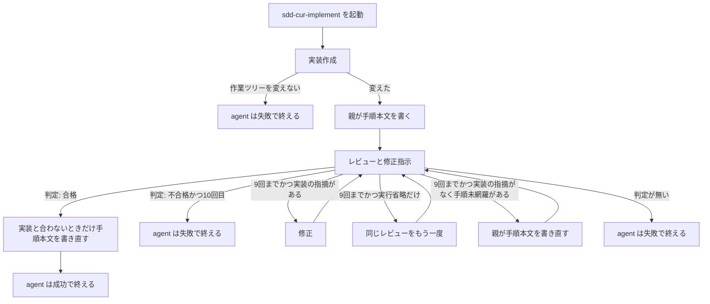

# 40 実装レビューでテストを実行し受け入れ条件を網羅する

対象は [Issue #40](https://github.com/paterapatera/sdd-cur/issues/40)。実装レビューは、対象課題の設計の「テスト」節を作業ツリーで実行し、受け入れ手順が設計の受け入れ条件を一通り確かめられるかを見る。実装作成、レビュー、修正、10 回の打ち切り、不合格が続いたあとの high、親が手順本文を書く流れは、今の `sdd-cur-implement` のままである。

## 受け入れ条件

- 実装レビューは、対象課題の設計の見出しが `テスト` の節に実行すべき記述があるとき、その節を、書かれた順にすべて実行してからでなければ、合格としない。
- 見出しが `テスト` の節が無いとき、またはどの節にも実行すべき記述が無いときは、テストの実行は省略する。実行すべき記述が無い節は、その節だけ実行しない。
- そのときも、実装レビューは読み取りレビューを行う。
- そのときも、実装レビューは受け入れ手順の網羅を行う。
- 設計の「テスト」節を実行する主体は、実装レビュー役である。
- 設計の「テスト」節を実行する場所は、作業ツリーである。
- 実行すべき記述は、バッククォートまたはコードフェンスの中のコマンド行と、明示的な手順の箇条書きである。それ以外の文は実行しない。
- 実行とは、実行すべき記述を書かれたとおり行うことである。例は、`bun test` と、節の箇条書きに沿う実行である。
- 見出しが `テスト` の節が複数あるときは、実行すべき記述がある節を、書かれた順にすべて実行する。一つの節の失敗で、残りの節を飛ばさない。
- 失敗は、起動したコマンドの終了コードが 0 以外である。終了コードが 0 のコマンドは、失敗ではない。
- 設計の「テスト」節の実行が失敗しているとき、その失敗のままでは、実装レビューは合格としない。
- 実装レビュー役の `readonly: true` は維持する。テストの実行が触るのは、一時ディレクトリと、既存のテスト用一時ファイルだけである。実装の意図的な編集はしない。
- 設計の「テスト」節に書かれた実行が禁止と矛盾するときは、その節に書かれた実行を優先する。優先するのは、その節の範囲だけである。節の外では、禁止のとおりである。この優先でも、`readonly: true` は外さない。実装の意図的な編集はしない。
- 設計の「テスト」節の実行が失敗したときは、既存の不合格として、実装の修正ループへ進む。
- 設計の「テスト」節の実行の失敗は、実装の指摘に含む。
- 設計の「テスト」節の実行が失敗しているとき、その失敗のままでは、`sdd-cur-implement` は成功で終えない。
- 実装の指摘があるときは、実装の修正ループを優先する。
- 実装の指摘があるあいだ、親は手順本文を書き直さない。
- 実装レビューは、受け入れ手順が受け入れ条件を一通り確かめられることをレビューする。
- 突き合わせる受け入れ条件は、対象課題の設計の受け入れ条件のみである。
- 受け入れ手順が受け入れ条件を一通り確かめられるとは、各受け入れ条件について、手順どおりに実行すれば成否が分かることである。
- 設計に受け入れ条件の節が無いとき、またはその節に項目が無いときは、突き合わせる対象が無い。網羅は満たす。
- 受け入れ手順が受け入れ条件を一通り確かめられないとき、その状態のままでは、実装レビューは合格としない。
- 受け入れ手順が受け入れ条件を一通り確かめられず、実装の指摘が無いときは、不合格とする。
- 受け入れ手順が受け入れ条件を一通り確かめられず、実装の指摘が無く、既存の実装レビューの不合格回数が 10 に達していないときは、親が手順本文を書き直す。
- その書き直しのあとは、再レビューする。
- 受け入れ手順が受け入れ条件を一通り確かめられず、実装の指摘が無いときの不合格では、実装修正役は起動しない。
- 手順未網羅による不合格は、既存の実装レビューの不合格回数に数える。
- 手順未網羅による不合格は、10 回の打ち切りに含む。
- 手順未網羅による不合格は、不合格が続いたあとの high へのエスカレーションに含む。
- 既存の実装レビューの不合格回数が 10 に達したときは、手順未網羅だけであっても、既存の 10 回打ち切りと同じである。
- そのとき、実装修正役は起動しない。
- そのとき、次のレビューをしない。
- そのとき、親による手順の書き直しをしない。
- 受け入れ手順が受け入れ条件を一通り確かめられないとき、その状態のままでは、`sdd-cur-implement` は成功で終えない。
- 親が手順を書き直したあとの再レビューでも、実行すべき記述がある「テスト」節は、毎回、書かれた順にすべて実行する。一つの節の失敗で、残りの節を飛ばさない。
- 親が手順を書き直したあとの再レビューで、節が無いとき、または実行すべき記述が無いときは、実行を省略する。

## 範囲外

次は作らない。

- 手順コメントの投稿
- 手順をマージリクエストの概要へ移すこと
- 要求のレビューと設計のレビュー
- 課題の作成とクローズ
- ラベルの変更
- 完了処理
- Forgejo、Jira、Backlog
- 実装作成役と実装修正役のファイルの変更
- `skills/sdd-cur/SKILL.md` の変更
- `src/runner.ts`、`src/agent.ts`、`src/run.ts`、`src/cli.ts`、`src/sdd.ts`、`src/install.ts`、`src/github.ts`、`src/complete.ts`、`src/conventions.ts` の変更
- 不合格回数の新しいカウンタ。10 回という数の変更。打ち切り理由の文言の変更
- 判定行の読み方の変更。印が壊れているときのやり直しの変更
- `docs/plan.md`、`docs/conventions.md`、README、AGENTS.md、この課題以外の `design.md` と `requirements.md` の書き換え
- 依存パッケージ。`package.json` の変更

## 決定

人が決めた条件は、要求の「決定」と、実行すべき記述、失敗、`readonly`、テストが触るもの、受け入れ条件が無いとき、節が複数、禁止との優先である。

| 項目 | 内容 |
|---|---|
| 変えるファイル | `skills/sdd-cur-implement/SKILL.md` の「実装」のうち手順本文を書き直す時機と、「レビュー」。`agents/sdd-cur-implement-reviewer.md` の本文。この二つの文言を確かめる `src/runner.test.ts` と `src/agents.test.ts` |
| レビュー役の frontmatter | `name`、`description`、`model` は変えない。`readonly: true` は維持する。今の `model` は `grok-4.7[context=256k,reasoning_effort=medium,fast=false]` である |
| 実行の主体 | 実装レビュー役。親はテスト節を実行しない |
| 実行の場所 | 作業ツリー |
| 実行すべき記述 | バッククォートまたはコードフェンスの中のコマンド行と、明示的な手順の箇条書きである。それ以外の文は実行しない |
| 実行 | 実行すべき記述を、書かれたとおり行う。別のコマンドに替えない。節に無いテストを足さない。例は、`bun test` と、節の箇条書きに沿う実行である |
| 節が複数 | 見出しが `テスト` の節が複数あるときは、実行すべき記述がある節を、書かれた順にすべて実行する。一つの節の失敗で、残りの節を飛ばさない。実行すべき記述が無い節は実行しない |
| 実行の省略 | 見出しが `テスト` の節が無いとき、またはどの節にも実行すべき記述が無いときは、実行しない。省略したことだけでは不合格にしない |
| 失敗 | 起動したコマンドの終了コードが 0 以外である。終了コードが 0 のコマンドは、失敗ではない。終了コードが 0 以外のコマンドが一つでもあるとき、その実行は失敗である |
| テストが触るもの | `readonly: true` は維持する。テストの実行が触るのは、一時ディレクトリと、既存のテスト用一時ファイルだけである。実装の意図的な編集はしない |
| 禁止との優先 | 設計の「テスト」節に書かれた実行が禁止と矛盾するときは、その節に書かれた実行を優先する。優先するのは、その節の範囲だけである。節の外では、禁止のとおりである。この優先でも、`readonly: true` は外さない。実装の意図的な編集はしない。ここでいう禁止は、レビュー役に書いた禁止と、スキルの `## 禁止` である |
| 読み取りレビュー | 作業ツリーの実装が要求どおりに作られているかと、設計通りに作られているかを読むこと。テストを実行するときも、省略するときも、行う |
| 網羅 | 受け入れ手順が、対象課題の設計の受け入れ条件を一通り確かめられることのレビュー。テストを実行するときも、省略するときも、行う。要求ファイルの受け入れ条件は突き合わせに使わない。設計に受け入れ条件の節が無いとき、またはその節に項目が無いときは、突き合わせる対象が無い。網羅は満たす |
| 一通り | 設計の受け入れ条件の各項目について、手順どおりに実行すれば成否が分かること。項目が無いときは、突き合わせる対象が無い。網羅は満たす |
| 実装の指摘 | 作業ツリーの実装が要求どおりでないこと、設計通りでないこと、および設計の「テスト」節の実行の失敗。失敗は、起動したコマンドの終了コードが 0 以外である |
| テスト節の実行省略 | 実行すべき記述がある見出し `テスト` の節を、終了コードの失敗がなく、書かれた順にすべて実行していないこと。実装の指摘には含めない。手順未網羅ではない |
| 実行省略のやり直し | 判定が `判定: 不合格` で、実装の指摘が無く、手順未網羅が無く、テスト節の実行省略だけがあるとき、同じレビューをもう一度起動する。不合格回数は増やさない。修正役は起動しない。親は手順本文を書き直さない。モデルは、その数えるレビューと同じである |
| 手順未網羅 | 受け入れ手順が、設計の受け入れ条件を一通り確かめられないこと。実装の指摘には含めない。設計に受け入れ条件の節が無いとき、またはその節に項目が無いときは、突き合わせる対象が無い。網羅は満たす。手順未網羅ではない |
| 優先 | 実装の指摘があるときは、修正ループへ進む。手順未網羅が同時にあっても、親は手順本文を書き直さない |
| 手順未網羅だけ | 不合格にする。修正役は起動しない。不合格回数が 10 に達していなければ、親が同じパスの手順本文を書き直し、再レビューする |
| 回数 | 今の実装レビューの不合格回数だけを使う。別の回数は作らない。開始時は 0。この一回の agent 起動の中だけで数える。判定行が `判定: 不合格` のときに 1 増やす。手順未網羅だけの不合格も増やす。印が壊れているやり直しでは増やさない。テスト節の実行省略だけのやり直しでは増やさない |
| 打ち切り | 増やした回数が 10 のときは、手順未網羅だけであっても、修正役を起動しない。次のレビューをしない。親は手順本文を書き直さない。理由は `実装レビューが不合格のまま10回に達した`。agent は失敗で終える |
| high | 1 回目と 2 回目は model を渡さない。1 回目と 2 回目が続けて不合格のとき、3 回目から model に `grok-4.7-high` を渡す。合格まで渡す。手順未網羅だけの不合格も、この連続に数える。10 回目も、その回が 3 以上なら high を渡してから判定を見る |
| 再レビューの実行 | 手順を書き直したあとの再レビューは、数えるレビューである。モデルは、その回数の渡し方のままである。実行すべき記述がある「テスト」節は、毎回、書かれた順にすべて実行する。一つの節の失敗で、残りの節を飛ばさない。節が無いとき、または実行すべき記述が無いときは、実行を省略する |
| 合格後の手順 | 判定が合格のあと、最初の本文が実装と合わないときだけ、親が同じパスの本文を書き直す。この書き直しのあとにはレビューへ戻らない。実装と合っているときは書き直さない |
| 手順の渡し方 | サブエージェントには手順パスを渡さない。親は、レビュー役へ受け入れ手順の本文を渡す。レビュー役は手順ファイルを変えない |
| 手順本文の形 | 親が書くどの本文も、印の行は書かない。成功で終える前の本文は、空でなく、最初の非空行は印ではない |
| 指摘の置き場所 | レビュー役のレスポンスだけ。ファイルにも課題コメントにも残さない |
| 成功 | 判定が合格のときだけ、agent は成功で終える。テストの失敗のまま、または手順未網羅のままでは、成功で終えない |

| レビューの結果 | 回数を増やしたあと | すること |
|---|---|---|
| 合格 | 増やさない | 修正役は起動しない。手順本文が実装と合わないときだけ書き直す。成功で終える |
| 不合格。実装の指摘がある | 9 以下 | 手順本文は書き直さない。差分だけを修正へ渡す。修正のあと、レビューに戻る。実装作成役は起動しない |
| 不合格。実装の指摘が無い | 9 以下 | 修正役は起動しない。親が手順本文を書き直す。そのあと、レビューに戻る。実装作成役は起動しない |
| 不合格 | 10 | 修正役も次のレビューも起動しない。手順本文は書き直さない。失敗で終える |
| 判定が無い | 増やさない | 今のやり直し。2 回目も無いときは `レビューの判定がありません` で失敗する。手順本文は書き直さない |
| 不合格。テスト節の実行省略だけ | 増やさない | 修正役は起動しない。手順本文は書き直さない。同じレビューをもう一度起動する。モデルは、その数えるレビューと同じである |

実装の指摘がある不合格は、テスト節の実行の失敗を含む。失敗は、起動したコマンドの終了コードが 0 以外である。読み取りレビューの指摘も含む。設計に受け入れ条件の節が無いとき、またはその節に項目が無いときは、突き合わせる対象が無い。網羅は満たす。このことだけでは不合格にしない。

## 関係する課題

### #22 実装後にレビューと指摘をする

実装作成が作業ツリーを変えたあと、レビューの前に、親が手順本文を書く。不合格なら修正のあとレビューに戻り、10 回目の不合格で打ち切る。合格のときは、手順本文が実装と合わないときだけ書き直す。課題ランナーは、レビューのために別の agent を起動しない。この流れは残す。

### #29 手順を置く場所

手順を置く場所は、#29 のままである。受け入れ手順が受け入れ条件を一通り確かめられるかの検査は、#29 には無い。その検査は、この設計が `sdd-cur-implement` のレビューに足す。

### #30 と #43

起動する実装の役は、作成、レビューと修正指示、修正の三つである。修正案作成役は起動しない。判定行は、レスポンス本文を下から見て、行全体が `判定: 合格` または `判定: 不合格` と一致する最初の行である。`確認: あり` と `確認: なし` では分岐しない。印が壊れているときは、同じレビューをあと 1 回だけやり直し、回数は増やさない。

## レビュー役

`agents/sdd-cur-implement-reviewer.md` の本文を、この節に合わせる。`name`、`description`、`model` は変えない。`readonly: true` は維持する。

本文は日本語である。課題を作らない。課題を閉じない。ラベルを変えない。コミットしない。push しない。マージリクエストを作らない。スカッシュマージしない。コメントを投稿しない。`gh` を直接起動しない。受け入れ手順を投稿しない。完了処理をしない。確認コメントを投稿しない。人に確認しない。`確認: あり` も `確認: なし` も書かない。要求ファイルを作らない。要求ファイルは変えない。設計ファイルを作らない。設計ファイルは変えない。手順ファイルは変えない。実装を修正しない。

実行すべき記述は、バッククォートまたはコードフェンスの中のコマンド行と、明示的な手順の箇条書きである。それ以外の文は実行しない。

設計の「テスト」節に書かれた実行は、作業ツリーで行う。この実行は、実装の修正ではない。見出しが `テスト` の節が複数あるときは、実行すべき記述がある節を、書かれた順にすべて実行する。一つの節の失敗で、残りの節を飛ばさない。実行すべき記述が無い節は実行しない。節が無いときは実行しない。

失敗は、起動したコマンドの終了コードが 0 以外である。終了コードが 0 のコマンドは、失敗ではない。終了コードが 0 以外のコマンドが一つでもあるとき、その実行は失敗である。

`readonly: true` は維持する。テストの実行が触るのは、一時ディレクトリと、既存のテスト用一時ファイルだけである。実装の意図的な編集はしない。

設計の「テスト」節に書かれた実行が禁止と矛盾するときは、その節に書かれた実行を優先する。優先するのは、その節の範囲だけである。節の外では、禁止のとおりである。この優先でも、`readonly: true` は外さない。実装の意図的な編集はしない。ここでいう禁止は、この節に書いた禁止と、スキルの `## 禁止` である。

### 起動時

1. 親が渡した課題番号、要件、設計、作業ツリーの実装、受け入れ手順の本文を読む。手順パスは受け取らない。
2. レビューの対象は、作業ツリーの実装と、受け入れ手順の本文である。要求ファイルと設計ファイルそのものはレビューしない。設計の「テスト」節を実行することと、設計の受け入れ条件と手順を突き合わせることは、設計ファイルの出来をレビューすることではない。

### 毎回のレビュー

合格とする前に、次を終える。修正のあとのレビューでも、手順本文を書き直したあとの再レビューでも、同じである。

- 読み取りレビューを行う。
- 見出しが `テスト` の節を、書かれた順に見る。実行すべき記述がある節は、作業ツリーで実行する。実行すべき記述は、バッククォートまたはコードフェンスの中のコマンド行と、明示的な手順の箇条書きである。見出しが `テスト` の節が複数あるときは、実行すべき記述がある節を、書かれた順にすべて実行する。一つの節の失敗で、残りの節を飛ばさない。実行すべき記述が無い節は実行しない。節が無いときは実行しない。
- 失敗は、起動したコマンドの終了コードが 0 以外である。終了コードが 0 のコマンドは、失敗ではない。
- テストの実行が触るのは、一時ディレクトリと、既存のテスト用一時ファイルだけである。実装の意図的な編集はしない。`readonly: true` は維持する。
- 受け入れ手順の本文が、設計の受け入れ条件を一通り確かめられるかを見る。設計に受け入れ条件の節が無いとき、またはその節に項目が無いときは、突き合わせる対象が無い。網羅は満たす。

### 指摘にするもの

次を指摘する。既存の、要求どおりでないことと、設計通りでないことは残す。

- 作業ツリーの実装が、要求どおりでない。
- 作業ツリーの実装が、設計通りでない。
- 設計の「テスト」節の実行が失敗した。失敗は、起動したコマンドの終了コードが 0 以外である。
- 実行すべき記述がある見出し `テスト` の節を、終了コードの失敗がなく、書かれた順にすべて実行していない。これは実装の指摘ではない。手順の未網羅でもない。
- 受け入れ手順が、設計の受け入れ条件のどれかについて、手順どおりに実行しても成否が分からない。設計に受け入れ条件の節が無いとき、またはその節に項目が無いときは、突き合わせる対象が無い。網羅は満たす。このことは指摘にしない。

好み、文体だけの提案、要求にも設計にも無い仕組みの追加案は、指摘にしない。テストの失敗と、手順の未網羅は、好みではない。

実装の指摘は、上の箇条のうち、要求どおりでないこと、設計通りでないこと、テスト節の実行の失敗である。失敗は、起動したコマンドの終了コードが 0 以外である。テスト節の実行省略と、手順の未網羅は、実装の指摘ではない。設計に受け入れ条件の節が無いとき、またはその節に項目が無いときは、手順の未網羅ではない。

### 出力

日本語の常体で書く。合格でも不合格でも、次の三項目を必ず出す。人に確認しない。

1. 指摘。実装の指摘があるときは、作業ツリー上のどこ（パス等）の何が、要求または設計のどの点に反するかを書く。テスト節の実行の失敗は、実行したコマンドと、終了コードが 0 以外であることを書く。実装の指摘が無いときは、「実装の指摘なし」と書く。テスト節の実行省略があるときは、実行していない節または記述を書く。実行省略だけのときも「実装の指摘なし」と書く。受け入れ手順については、設計の受け入れ条件のうち、成否が分からない項目を書く。すべての項目で成否が分かるときは、その旨を書く。設計に受け入れ条件の節が無いとき、またはその節に項目が無いときは、突き合わせる対象が無いことと、網羅は満たすことを書く。実装の指摘が無く、成否が分からない項目も無いときは、「指摘なし」と書いてよい。「指摘なし」は指摘が一つあることには数えない。「実装の指摘なし」は、手順の未網羅が無いことには数えない。テスト節の実行省略が無いことにも数えない。
2. パスごとの直す箇所と、変更後コードの差分。変える部分の差分だけである。全文は書かない。実装の指摘が無いときは「差分なし」と書いてよい。手順本文の差分は書かない。不合格で直す箇所があるときは、判定行より前に書く。
3. 判定。行全体が `判定: 合格` または `判定: 不合格` と一致する一行である。実装の指摘が一つでもあるときは `判定: 不合格` である。受け入れ手順が設計の受け入れ条件を一通り確かめられないときは `判定: 不合格` である。設計に受け入れ条件の節が無いとき、またはその節に項目が無いときは、突き合わせる対象が無い。網羅は満たす。このことだけでは `判定: 不合格` にしない。実行すべき記述がある見出し `テスト` の節を、終了コードの失敗がなく、書かれた順にすべて実行していないとき、または起動したコマンドの終了コードが 0 以外のときは、`判定: 合格` にしない。テスト節の実行省略だけのときも `判定: 不合格` である。実装の指摘が無く、テスト節の実行省略が無く、手順が設計の受け入れ条件を一通り確かめられ、テストの実行が設計どおり省略であるか成功であるときだけ、`判定: 合格` である。この行の後ろに非空行があっても、判定はこの行である。

指摘に無い変更は差分に書かない。要求にも設計にも無い仕組みを足す差分は書かない。要求ファイルと設計ファイルの変更は差分に書かない。

## スキルの手順

`skills/sdd-cur-implement/SKILL.md` のフロントマター、`## 禁止`、課題本文をデータとして読むことは残す。`## 実装` は、手順本文を書き直してよい時機以外を残す。`## レビュー` は、判定の読み方、回数、モデル、印が壊れているときのやり直し、失敗の理由の書き方を残し、テストと網羅の分岐を足す。

### 実装

作業ツリーを変えたあとは、親が受け入れ手順の本文を、渡された絶対パスへ書く。印の行は書かない。サブエージェントには手順パスを渡さない。

この本文は、レビューの前の最初の本文である。親が同じパスへ書き直すのは、次のときだけである。

- 判定が合格であり、本文が実装と合わない。
- 判定が不合格であり、実装の指摘が無く、手順未網羅があり、増やした不合格回数が 9 以下である。テスト節の実行省略が同時にあっても、同じである。

実装の指摘があるあいだは、書き直さない。不合格回数が 10 のときも、書き直さない。設計に受け入れ条件の節が無いとき、またはその節に項目が無いときは、突き合わせる対象が無い。網羅は満たす。このことだけでは手順本文を書き直さない。

### レビュー

レビューはこのスキルの中で行う。課題ランナーは、レビューのために別の agent を起動しない。指摘はどこにも置かない。人に確認しない。

親は、レビュー役へ受け入れ手順の本文を渡す。手順パスは渡さない。テスト節の実行は、レビュー役が行う。親は実行しない。

実行すべき記述は、バッククォートまたはコードフェンスの中のコマンド行と、明示的な手順の箇条書きである。それ以外の文は実行しない。見出しが `テスト` の節が複数あるときは、実行すべき記述がある節を、書かれた順にすべて実行する。一つの節の失敗で、残りの節を飛ばさない。実行すべき記述が無い節は実行しない。節が無いときは実行しない。

失敗は、起動したコマンドの終了コードが 0 以外である。終了コードが 0 のコマンドは、失敗ではない。終了コードが 0 以外のコマンドが一つでもあるとき、その実行は失敗であり、実装の指摘である。レスポンスは「実装の指摘なし」としない。

レビュー役の `readonly: true` は維持する。親は外さない。テストの実行が触るのは、一時ディレクトリと、既存のテスト用一時ファイルだけである。実装の意図的な編集はしない。

設計の「テスト」節に書かれた実行が禁止と矛盾するときは、その節に書かれた実行を優先する。優先するのは、その節の範囲だけである。節の外では、禁止のとおりである。この優先でも、`readonly: true` は外さない。実装の意図的な編集はしない。ここでいう禁止は、レビュー役に書いた禁止と、スキルの `## 禁止` である。

設計に受け入れ条件の節が無いとき、またはその節に項目が無いときは、突き合わせる対象が無い。網羅は満たす。このことだけでは不合格にしない。手順本文を書き直さない。

不合格の回数は、この一回の agent 起動の中だけで数える。開始時は 0 である。ファイルにも課題コメントにも書かない。ランナーが `implement` を再試行しても、回数は引き継がない。判定行が `判定: 不合格` のときに 1 増やす。手順未網羅だけの不合格も増やす。印が壊れているやり直しでは増やさない。テスト節の実行省略だけのやり直しでは増やさない。1 回目と 2 回目のレビューは model を渡さない。1 回目と 2 回目が続けて不合格のとき、3回目から model に `grok-4.7-high` を渡す。合格まで渡す。10 回目も、その回が 3 以上なら high を渡してから判定を見る。やり直しは、その回と同じ model である。手順未網羅だけの不合格は、この連続に数える。

判定行は、レスポンス本文を下から見て、行全体が `判定: 合格` または `判定: 不合格` と一致する最初の行である。その後ろに非空行があっても、その判定で進む。`確認: あり` と `確認: なし` では分岐しない。

一致する行が無いときは、同じレビューをあと 1 回だけやり直す。同じレビューの起動は、合計最大 2 回である。回数は増やさない。2 回目も無いときは、修正を起動しない。手順本文は書き直さない。理由は `レビューの判定がありません` である。agent は失敗で終える。`実装レビューが不合格のまま10回に達した` にはしない。

判定行が `判定: 合格` のときは、修正を起動しない。本文が実装と合わないときだけ、親が同じパスの本文を書き直す。この書き直しのあとにはレビューへ戻らない。印の行は書かない。成功で終える前の本文は、空でなく、最初の非空行は印ではない。

判定行が `判定: 不合格` のとき、レスポンスに「実装の指摘なし」とあり、実行すべき記述がある見出し `テスト` の節の実行省略だけがあるときは、回数は増やさない。手順未網羅ではない。修正役は起動しない。親は手順本文を書き直さない。同じレビューをもう一度起動する。モデルは、その数えるレビューと同じである。戻ったレビューでも、実行すべき記述がある「テスト」節は、レビュー役が、書かれた順にすべて実行する。一つの節の失敗で、残りの節を飛ばさない。

判定行が `判定: 不合格` のときは、上の実行省略のやり直しに当てはまらなければ、回数を 1 増やす。増やした回数が 10 のときは、修正も次のレビューも起動しない。親は手順本文を書き直さない。理由は `実装レビューが不合格のまま10回に達した` である。agent は失敗で終える。手順未網羅だけであっても、同じである。

増やした回数が 9 以下のとき、レスポンスに「実装の指摘なし」と無いときは、実装の指摘がある。人に確認しない。手順本文は書き直さない。修正指示は変える部分の差分だけであり、全文は書かない。差分だけを修正へ渡す。修正のあと、レビューと修正指示に戻る。不合格のあと、実装作成役は起動しない。戻ったレビューでも、実行すべき記述がある「テスト」節は、レビュー役が、書かれた順にすべて実行する。一つの節の失敗で、残りの節を飛ばさない。失敗は、起動したコマンドの終了コードが 0 以外である。

増やした回数が 9 以下のとき、レスポンスに「実装の指摘なし」とあり、手順未網羅があるときは、修正役は起動しない。親が同じパスの手順本文を書き直す。テスト節の実行省略が同時にあっても、同じである。印の行は書かない。書き直した本文は、受け入れ条件を一通り確かめられるものとする。各項目について、手順どおりに実行すれば成否が分かる。そのあと、レビューに戻る。戻ったレビューは、数えるレビューである。モデルは、その回数の渡し方である。実行すべき記述がある「テスト」節は、毎回、書かれた順にすべて実行する。一つの節の失敗で、残りの節を飛ばさない。節が無いとき、または実行すべき記述が無いときは、実行を省略する。

10 回目のレビューで印が壊れているときは、まだ不合格ではない。同じ model で、そのレビューをもう 1 回起動する。2 回目の判定行が `判定: 不合格` のとき、回数は 10 になり、10 回の理由で失敗する。手順本文は書き直さない。2 回目も印が壊れているときは、回数を増やさず、`レビューの判定がありません` で失敗する。2 回目の判定行が `判定: 合格` のときは、合格として進む。

失敗で終えるとき、終了コードは 0 以外である。理由は日本語の一行であり、標準エラーの最初の非空行、それが空のときは標準出力の最初の非空行に書く。成功の完了では終えない。テストの失敗のまま、または手順未網羅のままでは、成功で終えない。成功で終えたとき、ランナーは手順ファイルを読み、受け入れ手順のコメントと実装完了へ進む。

図の「判定が無い」は、印が壊れているやり直しを使い切ったあとである。やり直しのあいだは、修正も手順の書き直しもしない。図の「実行省略だけ」は、不合格回数を増やさない。修正も手順の書き直しもしない。

## テスト

`bun test` で実行する。一時ディレクトリを使い、終わったら消す。`gh` は起動しない。ホームディレクトリと、実行中の Cursor のスキルおよびサブエージェントは触らない。

`src/agents.test.ts` の実装レビュー役の `bodyIncludes` に、次を足す。既存の期待は残す。`model` の期待は、今の `grok-4.7[context=256k,reasoning_effort=medium,fast=false]` のままである。

- `実装の指摘なし`
- `「テスト」節`
- `一通り確かめられる`
- `作業ツリー`
- `バッククォートまたはコードフェンス`
- `明示的な手順の箇条書き`
- `終了コードが 0 以外`
- `終了コードが 0 のコマンドは、失敗ではない`
- `readonly: true`
- `一時ディレクトリ`
- `既存のテスト用一時ファイル`
- `実装の意図的な編集はしない`
- `書かれた順にすべて実行する`
- `残りの節を飛ばさない`
- `突き合わせる対象が無い`

実装レビュー役の本文に、`判定: 合格`、`判定: 不合格`、`全文は書かない`、`人に確認しない`、`行全体` があることは残す。`最後の非空行` は無い。`人に確認しない` と、`` `確認: あり` も `確認: なし` も書かない `` があることは残す。`readonly: true` は、フロントマターに残る。

`src/runner.test.ts` の `skills/sdd-cur-implement/SKILL.md` の必須文言は、今の一覧を残す。加えて、次が含まれる。

- `「テスト」節`
- `実装の指摘なし`
- `一通り確かめられる`
- `手順本文を書き直す`
- `修正役は起動しない`
- `バッククォートまたはコードフェンス`
- `明示的な手順の箇条書き`
- `終了コードが 0 以外`
- `終了コードが 0 のコマンドは、失敗ではない`
- `readonly: true`
- `一時ディレクトリ`
- `既存のテスト用一時ファイル`
- `実装の意図的な編集はしない`
- `書かれた順にすべて実行する`
- `残りの節を飛ばさない`
- `突き合わせる対象が無い`

`src/sdd.test.ts` と `src/install.test.ts` の期待は、この課題では変えない。

## 実装の順序

1. `agents/sdd-cur-implement-reviewer.md` の本文を、この設計のレビュー役に合わせる。`src/agents.test.ts` を通す。
2. `skills/sdd-cur-implement/SKILL.md` の「実装」と「レビュー」を、この設計の手順に合わせる。`src/runner.test.ts` の必須文言を足す。
3. `bun test` が成功することを確かめる。
